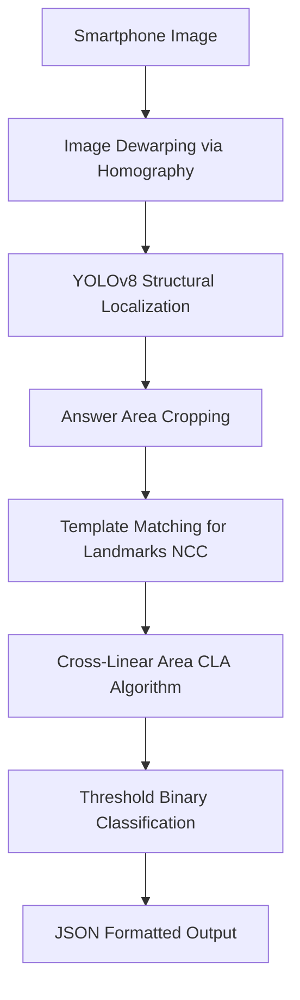
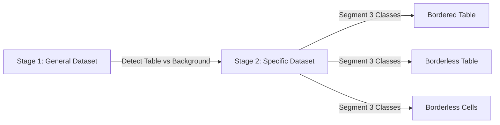

# สรุปสูตรคณิตศาสตร์และกระบวนการคำนวณจากงานวิจัย (Research Papers Summary)
**โฟลเดอร์แหล่งข้อมูล:** `Rayong_MARCO_Template/IMG_Template_All/Example_paper`

---

## สารบัญ
1. [Automated Optical Marker Exam Recognition using Cross-Linear Area Detection (SNPD 2025)](#1-automated-optical-marker-exam-recognition-using-cross-linear-area-detection)
2. [DocUNet: Document Image Unwarping via a Stacked U-Net (CVPR 2018)](#2-docunet-document-image-unwarping-via-a-stacked-u-net)
3. [OMRNet: A Lightweight Deep Learning Model for Optical Mark Recognition (MTAP 2024)](#3-omrnet-a-lightweight-deep-learning-model-for-optical-mark-recognition)
4. [CascadeTabNet: An Approach for End-to-End Table Detection and Structure Recognition (CVPRW 2020)](#4-cascadetabnet-an-approach-for-end-to-end-table-detection-and-structure-recognition)
5. [TrOCR: Transformer-based Optical Character Recognition with Pre-trained Models (AAAI 2023)](#5-trocr-transformer-based-optical-character-recognition-with-pre-trained-models)
6. [ตารางเปรียบเทียบและการนำไปประยุกต์ใช้กับระบบตรวจข้อสอบ](#6-ตารางเปรียบเทียบและการนำไปประยุกต์ใช้)

---

## 1. Automated Optical Marker Exam Recognition using Cross-Linear Area Detection
> **ผู้แต่ง:** Watcharaphong Yookwan, Jirayus Arbking, et al. (Faculty of Informatics, Burapha University)  
> **ตีพิมพ์:** IEEE SNPD 2025  
> **ไฟล์ต้นฉบับ:** `Automated Optical Marker Exam Recognition using Cross-Linear Area Detection from Smartphone Camera .pdf`

### 1.1 วัตถุประสงค์หลัก
ตรวจกระดาษคำตอบ OMR อัตโนมัติจากภาพถ่ายกล้องสมาร์ตโฟนทั่วไปที่มีปัญหามุมถ่ายเอียง (Perspective distortion), สภาพแสงไม่สม่ำเสมอ และเงาตกกระทบ โดยไม่ต้องใช้เครื่องสแกนความเร็วสูงราคาแพง

---

### 1.2 ลำดับขั้นตอนการทำงาน (Pipeline Architecture)

---

### 1.3 สูตรคณิตศาสตร์และวิธีคิดคำนวณ

#### (1) การดัดระนาบภาพเอกสาร (Perspective Dewarping via Homography)
ใช้สมการการแปลงระนาบโปรเจกทีฟ (Projective Homography):
$$\begin{bmatrix} x' \\ y' \\ 1 \end{bmatrix} \sim \mathbf{H} \begin{bmatrix} x \\ y \\ 1 \end{bmatrix} = \begin{bmatrix} h_{11} & h_{12} & h_{13} \\ h_{21} & h_{22} & h_{23} \\ h_{31} & h_{32} & h_{33} \end{bmatrix} \begin{bmatrix} x \\ y \\ 1 \end{bmatrix}$$
* **พารามิเตอร์:**
  * $(x, y)$: พิกัดจุดบนภาพต้นฉบับที่บิดเบี้ยว
  * $(x', y')$: พิกัดเป้าหมายบนกระดาษสี่เหลี่ยมผืนผ้ามุมมองตรง (Top-Down Rectified View)
  * $\mathbf{H} \in \mathbb{R}^{3 \times 3}$: เมทริกซ์โฮโมกราฟี (มีอิสระ 8 องศา)
* **วิธีคิดคำนวณ:**
  1. ใช้ Canny Edge Detection ตรวจจับขอบ แล้วค้นหาโครงร่างสี่เหลี่ยมด้านไม่เท่าที่ใหญ่ที่สุด (Largest Quadrilateral Contour)
  2. จัดเรียงจุดยอด 4 จุดตามลำดับ: บน-ซ้าย ($TL$), บน-ขวา ($TR$), ล่าง-ขวา ($BR$), ล่าง-ซ้าย ($BL$)
  3. คำนวณหาค่าในเมทริกซ์ $\mathbf{H}$ ด้วยวิธี **Direct Linear Transformation (DLT)**
  4. ทำการ Warp ภาพกลับด้วย $\mathbf{H}^{-1}$ (Inverse Mapping) พร้อมทำ Bilinear Interpolation

---

#### (2) การค้นหาจุดหมุดอ้างอิงด้วย Normalized Cross-Correlation (NCC)
ใช้สแกนหาจุดตัดหรือมาร์กเกอร์รูปกากบาท (Cross markers) เพื่อจัดแนวเส้นกริดคำตอบ:
$$R(x, y) = \frac{\sum_{i, j} \Big(I(x+i, y+j) - \bar{I}_{x,y}\Big) \cdot \Big(T(i, j) - \bar{T}\Big)}{\sqrt{\sum_{i, j} \Big(I(x+i, y+j) - \bar{I}_{x,y}\Big)^2 \cdot \sum_{i, j} \Big(T(i, j) - \bar{T}\Big)^2}}$$
* **พารามิเตอร์:**
  * $T \in \mathbb{R}^{h \times w}$: ภาพแม่แบบ Landmark ขนาด $h \times w$, โดยมี $\bar{T}$ เป็นความสว่างเฉลี่ยของแม่แบบ
  * $I$: ภาพบริเวณกรอบข้อสอบที่ถูกตัดมา (Cropped Answer Area)
  * $\bar{I}_{x,y}$: ความสว่างเฉลี่ยของพื้นที่ใต้ Patch ขนาด $h \times w$ ณ ตำแหน่ง $(x, y)$
  * $R(x, y) \in [-1, 1]$: ค่าสัมประสิทธิ์ความสอดคล้อง
* **วิธีคิดคำนวณ:**
  * เมื่อเลื่อน $T$ ทาบไปทั่วภาพ ตำแหน่ง $(x^*, y^*)$ ที่ได้ค่า $R$ สูงสุดใกล้ $1.0$ จะถูกระบุเป็นจุดพิกัดกึ่งกลางของหมุดอ้างอิง

---

#### (3) อัลกอริทึม Cross-Linear Area (CLA) สำหรับตรวจการฝนคำตอบ
แทนการตัดเกณฑ์รวมทั้งภาพ (Global Thresholding) ซึ่งล้มเหลวบ่อยเมื่อมีเงาพาดผ่าน อัลกอริทึมนี้จะลากเส้นตรงกากบาทตัดผ่านจุดกึ่งกลางของวงกลมคำตอบ แล้ววัดอัตราส่วนความหนาแน่นของพิกเซลมืด:
$$\text{Fill Ratio} = \frac{\sum_{p \in \mathcal{P}_{\text{cross}}} \mathbb{I}(I(p) < \tau_{\text{dark}})}{|\mathcal{P}_{\text{cross}}|}$$
* **พารามิเตอร์:**
  * $\mathcal{P}_{\text{cross}}$: เซตของพิกเซลทั้งหมดที่อยู่บนเส้นแกนตัดแนวนอนและแนวตั้ง (รวมรัศมีขยาย $r$ รอบจุดกึ่งกลาง)
  * $\mathbb{I}(\cdot)$: ฟังก์ชันเงื่อนไข (คืนค่า 1 เมื่อพิกเซลมีความเข้มมากกว่าเกณฑ์ความมืด $\tau_{\text{dark}}$, คืนค่า 0 หากสว่าง)
  * $|\mathcal{P}_{\text{cross}}|$: จำนวนพิกเซลทั้งหมดบนแนวตรวจสอบ
* **เกณฑ์การตัดสิน (Decision Rule):**
  $$\text{Decision} = \begin{cases} \text{Filled (ฝนคำตอบ)}, & \text{ถ้า } \text{Fill Ratio} \ge \tau_{\text{filled}} \\ \text{Unfilled (ไม่ฝน)}, & \text{ถ้า } \text{Fill Ratio} < \tau_{\text{filled}} \end{cases}$$

---

## 2. DocUNet: Document Image Unwarping via a Stacked U-Net
> **ผู้แต่ง:** Ke Ma, Zhixin Shu, Xue Bai, Jue Wang, Dimitris Samaras (Stony Brook University & Megvii Inc.)  
> **ตีพิมพ์:** IEEE CVPR 2018  
> **ไฟล์ต้นฉบับ:** `DocUNet- Document Image Unwarping via a Stacked U-Net.pdf`

### 2.1 วัตถุประสงค์หลัก
คลี่เอกสารที่บิดเบี้ยว ยับ พับ หรือโค้งงอ (Crumpled/Folded/Curved paper) ให้กลับมาแบนราบสมบูรณ์แบบ End-to-End Deep Learning โดยทำนาย Coordinate Displacement Map

---

### 2.2 สูตรคณิตศาสตร์และวิธีคิดคำนวณ

#### (1) การจำลองการบิดเบี้ยวแบบ 2D (Synthetic Distortion Generation)
กำหนดโครงตาข่ายขนาด $m \times n$ บนภาพเรียบ ให้ $p$ เป็นจุดศูนย์กลางของแรงดัด และ $d$ เป็นระยะทางตั้งฉากแบบ Normalized จากจุดยอดไปยังแนวเส้นพับ/โค้ง:
* **กรณีรอยพับเป็นเส้นคม (Fold / Crease):**
  $$w_{\text{fold}} = \frac{\alpha}{d + \alpha}$$
* **กรณีการโค้งงอเป็นลอน (Curve / Curl):**
  $$w_{\text{curve}} = 1 - d^\alpha$$
* **การขยับพิกัดยอดตาข่าย:**
  $$p_i' = p_i + w \cdot \mathbf{v}$$
  *(โดย $\mathbf{v}$ คือเวกเตอร์ทิศทางและขนาดแรง, $\alpha$ คือค่าควบคุมขอบเขตว่ารอยยับจะส่งผลเฉพาะจุดหรือลามทั่วทั้งแผ่น)*

---

#### (2) ฟังก์ชันการสูญเสียของโครงข่าย (DocUNet Loss Functions)
โครงข่ายทำนายพิกัด Displacement Mapping $F \in \mathbb{R}^{H \times W \times 2}$ เทียบกับ Ground Truth กำหนดให้ $d_i = y_i - y_i^*$:
* **Shift-Invariant Loss ($L_s$):** ควบคุมโครงสร้างรูปทรงเรขาคณิตสัมพัทธ์ระหว่างพิกเซลข้างเคียง ไม่ให้ภาพบิดเบี้ยวแม้พิกัดรวมจะขยับ
  $$L_s = \frac{1}{2n^2} \sum_{i,j} \Big( (y_i - y_j) - (y_i^* - y_j^*) \Big)^2 = \frac{1}{n}\sum_i d_i^2 - \left( \frac{1}{n} \sum_i d_i \right)^2$$
* **Foreground L1 Loss ($L_f$):** ใช้ L1 Loss เพื่อให้ขอบข้อความและตัวอักษรคมชัด
  $$L_f = \frac{1}{n}\sum_i |d_i| - \frac{\lambda}{n}\left| \sum_i d_i \right| \quad (\lambda = 0.1)$$
* **Background Hinge Loss ($L_b$):** ควบคุมพิกเซลพื้นหลังภายนอกกระดาษ (ซึ่งมีพิกัดเป็นลบ $\le -1$)
  $$L_b = \frac{1}{n}\sum_i \max(0, y_i)$$

---

## 3. OMRNet: A Lightweight Deep Learning Model for Optical Mark Recognition
> **ผู้แต่ง:** Sayan Mondal, Pratyay De, Samir Malakar, Ram Sarkar (Jadavpur University)  
> **ตีพิมพ์:** Multimedia Tools and Applications (2024)  
> **ไฟล์ต้นฉบับ:** `OMRNet.pdf`

### 3.1 วัตถุประสงค์หลัก
จำแนกช่องกาคำตอบ OMR รองรับ **3 คลาส**:
1. **Confirmed:** กาเลือกคำตอบอย่างถูกต้อง
2. **Crossed-out:** ขีดฆ่าหรือกากบาททับเพื่อยกเลิกคำตอบเดิม
3. **Empty:** เว้นว่าง ไม่ได้ตอบ

---

### 3.2 สูตรคณิตศาสตร์และวิธีคิดคำนวณ

#### (1) Sparse Categorical Cross-Entropy Loss
ใช้ในการเทรนโมเดลจำแนก 3 คลาส โดยใช้ Label แบบจำนวนเต็มเดี่ยว $y \in \{0, 1, 2\}$:
$$\mathcal{L}_{\text{SCCE}} = - \log P(y \mid X) = - \log \left( \frac{\exp(z_y)}{\sum_{j=1}^{C} \exp(z_j)} \right)$$
* **พารามิเตอร์:**
  * $C = 3$ (จำนวนคลาสทั้งหมด)
  * $z_j$: Logit Output ตัวที่ $j$ จาก Dense Layer ชั้นสุดท้าย
  * $y$: คลาสคำตอบจริง

#### (2) โครงสร้างชุดเลเยอร์กระตุ้นแบบผสม (Hybrid Activation Stacking)
เพื่อให้โมเดลสามารถดึง Feature ของเส้นขีดฆ่าที่มีมุมเอียงและความหนาต่างกันได้ดีที่สุด OMRNet ใช้การต่อสลับ Activation ดังนี้:
$$\text{Input Patch} \rightarrow \text{MobileNetV2 Bottleneck} \rightarrow \text{Dense}(\text{ReLU}) \rightarrow \text{Dense}(\text{Leaky ReLU}) \rightarrow \text{Dense}(\text{ELU}) \rightarrow \text{Softmax}$$
* **สูตร Leaky ReLU ($\alpha = 0.01$):**
  $$f(x) = \begin{cases} x, & x > 0 \\ 0.01x, & x \le 0 \end{cases}$$
  *(ป้องกันปัญหา Dead Neurons จากบริเวณพื้นผิวสีขาวว่างเปล่าในกระดาษ)*
* **ผลลัพธ์:** หลังการทำ INT8 Post-Training Quantization โมเดลมีขนาดเพียง **3 MB** และรักษาความแม่นยำได้สูงถึง **95.96%**

---

## 4. CascadeTabNet: An Approach for End-to-End Table Detection and Structure Recognition
> **ผู้แต่ง:** Devashish Prasad, Ayan Gadpal, Kshitij Kapadni, et al. (Pune Institute of Computer Technology)  
> **ตีพิมพ์:** CVPR Workshop 2020  
> **ไฟล์ต้นฉบับ:** `CascadeTabNet- An Approach for End-to-End Table Detection and Structure Recognition Using Cascade Mask R-CNN.pdf`

### 4.1 วัตถุประสงค์หลัก
ตรวจหาตำแหน่งตาราง (Table Detection) และสกัดโครงสร้างเซลล์/แถว/คอลัมน์ (Structure Recognition) รองรับทั้งตารางแบบมีเส้นขอบ (Bordered) และไม่มีเส้นขอบ (Borderless)

---

### 4.2 สูตรคณิตศาสตร์และวิธีคิดคำนวณ

#### (1) Multi-Stage Cascade Mask R-CNN
แก้ปัญหาตารางที่มีพื้นที่ว่างและเส้นตรงซ้อนทับกัน โดยการคัดกรอง Bounding Box ทีละขั้นด้วยการเพิ่มเกณฑ์ IoU Threshold เป็นลำดับขั้น:
$$U_1 = 0.5 \longrightarrow U_2 = 0.6 \longrightarrow U_3 = 0.7$$
* **สูตร IoU (Intersection over Union):**
  $$\text{IoU}(A, B) = \frac{\text{Area}(A \cap B)}{\text{Area}(A \cup B)}$$
* **Multi-task Loss แต่ละ Stage ($t = 1, 2, 3$):**
  $$\mathcal{L}^t = \mathcal{L}_{\text{cls}}(p^t, y^t) + \lambda [y^t \ge 1] \mathcal{L}_{\text{box}}(b^t, \hat{b}) + \mathcal{L}_{\text{mask}}(s, \hat{s})$$

#### (2) Two-Stage Fine-Tuning Strategy

* **ขั้นตอนหลังการตรวจจับ (Post-Processing):**
  * **กรณี Bordered Table:** สกัดเซลล์ผ่านการตัดกันของเส้นขอบ (Line Intersection) ด้วย Morphological Operation / Hough Lines
  * **กรณี Borderless Table:** นำ Mask เซลล์ที่โมเดลตรวจจับได้ มาจัดเรียงตามแกนพิกัด $(x, y)$ เพื่อประมาณเส้นแบ่ง Row / Column และคำนวณ Rowspan / Colspan

---

## 5. TrOCR: Transformer-based Optical Character Recognition with Pre-trained Models
> **ผู้แต่ง:** Minghao Li, Tengchao Lv, Lei Cui, et al. (Microsoft Research & Tsinghua University)  
> **ตีพิมพ์:** AAAI 2023  
> **ไฟล์ต้นฉบับ:** `TrOCR.pdf`

### 5.1 วัตถุประสงค์หลัก
อ่านข้อความและลายมือเขียน (Handwritten & Printed Text) โดยใช้โครงสร้าง Pure Transformer (Encoder-Decoder) ทั้งหมด ทดแทนสถาปัตยกรรมเดิมที่เป็น CNN + RNN/LSTM + CTC Loss

---

### 5.2 สูตรคณิตศาสตร์และวิธีคิดคำนวณ

#### (1) Vision Transformer Encoder (DeiT / BEiT)
แบ่งภาพข้อความบรรทัด $x_{\text{img}} \in \mathbb{R}^{H \times W \times C}$ ออกเป็นแพตช์ขนาด $P \times P$ จำนวน $N = \frac{HW}{P^2}$ ชิ้น:
$$z_0 = \Big[ x_{\text{class}}; \, x_p^1 \mathbf{E}; \, x_p^2 \mathbf{E}; \dots; \, x_p^N \mathbf{E} \Big] + \mathbf{E}_{\text{pos}}$$
* **พารามิเตอร์:**
  * $\mathbf{E} \in \mathbb{R}^{(P^2 C) \times D}$: เมทริกซ์โปรเจกชันเชิงเส้นแปลงพิกเซลเป็นเวกเตอร์มิติ $D$
  * $\mathbf{E}_{\text{pos}} \in \mathbb{R}^{(N+1) \times D}$: เวกเตอร์ระบุลำดับตำแหน่ง (1D Learnable Position Embedding)

#### (2) Scaled Dot-Product Multi-Head Attention
$$\text{Attention}(Q, K, V) = \text{softmax}\left(\frac{QK^T}{\sqrt{d_k}} + M\right) V$$
* **Decoder Masked Self-Attention:** มีการบวกค่า Mask $M_{ij} = -\infty$ เมื่อตำแหน่ง $j > i$ เพื่อไม่ให้ถอดรหัสคำล่วงหน้าได้ (Causal Autoregressive Masking)
* **Cross-Attention:** นำ Query ($Q$) จากฝั่งตัวหนังสือภาษา มาดึงสาระสำคัญจาก Key ($K$) และ Value ($V$) จากฝั่งรูปภาพ

#### (3) Autoregressive Sequence Cross-Entropy Loss
$$\mathcal{L}_{\text{TrOCR}} = - \sum_{t=1}^{T} \log P\big(y_t \mid y_{<t}, x_{\text{img}}\big)$$
* **วิธีคิดคำนวณตอนถอดรหัส (Inference):** เริ่มต้นส่ง Token `<s>` เข้าสู่ Decoder แล้วใช้กระบวนการ **Beam Search** เลือกชุดตัวอักษรที่มีผลรวมความน่าจะเป็นร่วมสะสมสูงสุด จนกระทั่งโมเดลทำนาย Token สิ้นสุดประโยค `</s>`

---

## 6. ตารางเปรียบเทียบและการนำไปประยุกต์ใช้

| งานวิจัย | งานหลักที่รับผิดชอบ | จุดเด่นด้านคณิตศาสตร์ / อัลกอริทึม | การนำไปประยุกต์ใช้กับ Lab9 / Rayong MARCO |
| :--- | :--- | :--- | :--- |
| **1. Cross-Linear Area (SNPD 2025)** | ตรวจกระดาษคำตอบ OMR จากมือถือ | • Homography (DLT) • Normalized Cross-Correlation (NCC) • Cross-Linear Density Ratio | **ตรงสายที่สุด** ใช้จัดระเบียบตารางคำตอบ และตรวจการฝนคำตอบได้อย่างแม่นยำแม้มีเงาพาด |
| **2. DocUNet (CVPR 2018)** | ดัดกระดาษเอกสารให้เรียบ | • 2D Mesh Deformation Functions • Shift-Invariant & L1 Loss • Background Hinge Loss | ใช้คลี่ภาพกระดาษคำตอบที่นักเรียนพับ ยับ ย่น หรือถ่ายเอียงมาก ๆ ให้แบนราบก่อนส่งต่อ |
| **3. OMRNet (MTAP 2024)** | จำแนกช่องกาคำตอบ 3 สถานะ | • Sparse Categorical Cross-Entropy • MobileNetV2 + Multi-Activation • INT8 Quantization (3 MB) | ใช้แก้ปัญหานักเรียนเปลี่ยนใจขีดฆ่าทับช่องเดิม แยกแยะระหว่าง "กาจริง", "ขีดฆ่า", และ "ว่าง" |
| **4. CascadeTabNet (CVPRW 2020)** | ตรวจจับโครงสร้างตาราง | • Cascade Mask R-CNN (IoU 0.5, 0.6, 0.7) • Two-stage Transfer Learning | ใช้ตรวจหากรอบตารางคะแนน หัวข้อสอบ หรือช่องรหัสที่ไม่มีเส้นขอบตารางชัดเจน |
| **5. TrOCR (AAAI 2023)** | สแกนอ่านตัวอักษรและลายมือ | • Vision Transformer Patch Projection • Masked Self-Attention & Cross-Attention • Autoregressive Beam Search | ใช้อ่านรหัสนักเรียน เลขที่ หรือชื่อ-นามสกุลที่เขียนด้วยลายมือลงบนหัวกระดาษคำตอบ |
