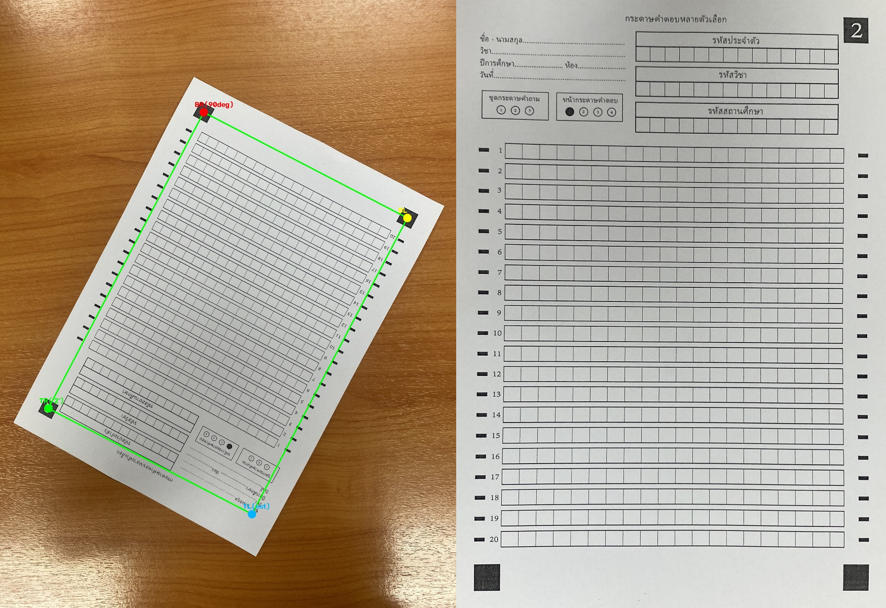
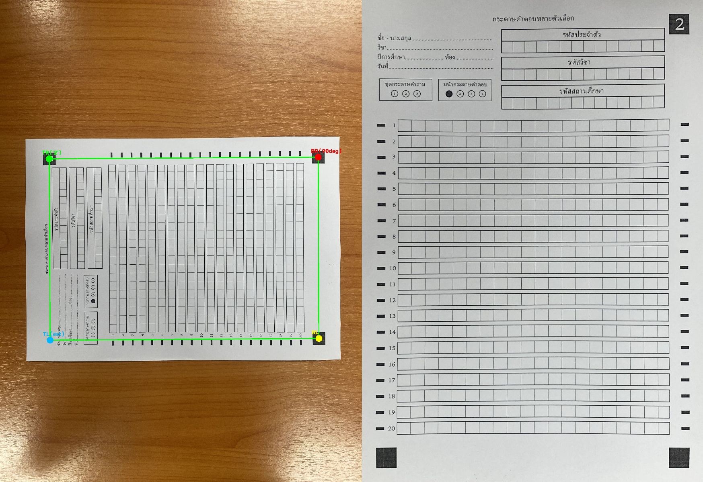

# รายงานตัวชี้วัดเชิงปริมาณ (Quantitative Metrics Report): Phase 1 — Preprocessing & Fiducial Dewarping

**ไฟล์โมดูลที่ประเมิน:** [`src/preprocessing/dewarp.py`](../src/preprocessing/dewarp.py) (`FiducialDewarper`)  
**สคริปต์ประเมินผล:** [`src/evaluation/evaluate_phase1.py`](../src/evaluation/evaluate_phase1.py)  
**ชุดข้อมูลทดสอบ:** [`data/raw/blank_papers/`](../data/raw/blank_papers/) (จำนวน 51 แผ่น)  
**ไฟล์ข้อมูลดิบ JSON:** [`metrics/phase1_evaluation_metrics.json`](./phase1_evaluation_metrics.json)

---

## 1. ตารางสรุปตัวชี้วัดหลักเทียบกับเกณฑ์เป้าหมาย (Executive SLA Summary)

| ตัวชี้วัดเชิงปริมาณ (Quantitative Metric) | สูตร/วิธีการวัดผล | เกณฑ์เป้าหมาย (Target SLA) | ผลลัพธ์ที่ได้จริง (Actual Result) | สถานะ |
|:---|:---|:---:|:---:|:---:|
| **1. 3-Marker Detection Rate** | อัตราการตรวจพบหมุดสี่เหลี่ยมดำครบทั้ง 3 มุม (`TR`, `BR`, `BL`) | $100.0\%$ | **$100.00\%$ (51 / 51 แผ่น)** | **PASS** |
| **2. Orientation Classification Accuracy** | ทดสอบหมุนภาพ 4 ทิศทาง ($0^\circ, 90^\circ, 180^\circ, 270^\circ$) จำนวน 80 เคส | $100.0\%$ | **$100.00\%$ (80 / 80 เคส)** | **PASS** |
| **3. Keypoint Reprojection RMSE** | ความคลาดเคลื่อนเฉลี่ยกำลังสองของพิกัดหมุดหลังทำ Homography Warp | $\le 3.000\text{ px}$ | **$0.114 \pm 0.048\text{ px}$** *(Median: $0.115\text{ px}$, Max: $0.238\text{ px}$)* | **PASS** |
| **4. Paper Boundary IoU** | สัดส่วนพื้นที่ซ้อนทับของขอบกระดาษหลังดัดระนาบเทียบกับแม่แบบ $2480 \times 3508$ | $\ge 0.9500$ | **$0.9873$** *(Min: $0.9307$, Max: $0.9949$)* | **PASS** |
| **5. Aspect Ratio Consistency** | ความสอดคล้องของสัดส่วนกว้าง/ยาวของกรอบหมุดเทียบกับค่าจริง ($0.6744$) | $\ge 98.00\%$ | **$99.14\%$** *(Min: $98.02\%$, Max: $99.98\%$)* | **PASS** |
| **6. Overall Dewarp Success Rate** | อัตราความสำเร็จรวม (พบครบ 3 หมุด และ $\text{RMSE} \le 3.0\text{ px}$) | $\ge 98.00\%$ | **$100.00\%$ (51 / 51 แผ่น)** | **PASS** |

---

## 2. ตัวอย่างภาพเปรียบเทียบก่อนและหลังดัดระนาบ (Visual Verification)

### 2.1 กรณีภาพถ่ายมุมเอียงบนพื้นโต๊ะไม้ (`blank_sheet_002.jpg`)

### 2.2 กรณีภาพถ่ายกลับหัว $180^\circ$ (`blank_sheet_004.jpg`)

---

## 3. ตารางผลลัพธ์เชิงปริมาณรายภาพครบทั้ง 51 แผ่น (Per-Sheet Granular Metrics)

| ลำดับ | ชื่อไฟล์ภาพ (Image File) | หมุดที่พบ | มุมหมุนของภาพตั้งต้น | Reprojection RMSE | Paper Boundary IoU | Aspect Consistency | TR Marker StdDev (`'2'`) | สถานะ |
|:---:|:---|:---:|:---:|:---:|:---:|:---:|:---:|:---:|
| 01 | `blank_sheet_001.jpg` | 3/3 | 0.00° | 0.000 px | 0.9949 | 99.98% | 99.30 | PASS |
| 02 | `blank_sheet_002.jpg` | 3/3 | 206.71° | 0.082 px | 0.9946 | 98.48% | 62.61 | PASS |
| 03 | `blank_sheet_003.jpg` | 3/3 | 34.04° | 0.094 px | 0.9935 | 98.27% | 64.02 | PASS |
| 04 | `blank_sheet_004.jpg` | 3/3 | 179.96° | 0.163 px | 0.9948 | 99.64% | 67.02 | PASS |
| 05 | `blank_sheet_005.jpg` | 3/3 | 217.53° | 0.056 px | 0.9859 | 98.18% | 66.58 | PASS |
| 06 | `blank_sheet_006.jpg` | 3/3 | 180.58° | 0.115 px | 0.9949 | 98.81% | 61.81 | PASS |
| 07 | `blank_sheet_007.jpg` | 3/3 | 351.20° | 0.062 px | 0.9947 | 99.45% | 59.56 | PASS |
| 08 | `blank_sheet_008.jpg` | 3/3 | 270.39° | 0.045 px | 0.9949 | 99.04% | 57.11 | PASS |
| 09 | `blank_sheet_009.jpg` | 3/3 | 350.65° | 0.123 px | 0.9946 | 99.37% | 57.33 | PASS |
| 10 | `blank_sheet_010.jpg` | 3/3 | 180.66° | 0.094 px | 0.9949 | 98.96% | 62.21 | PASS |
| 11 | `blank_sheet_011.jpg` | 3/3 | 352.71° | 0.107 px | 0.9949 | 99.35% | 60.62 | PASS |
| 12 | `blank_sheet_012.jpg` | 3/3 | 262.95° | 0.155 px | 0.9948 | 98.60% | 56.47 | PASS |
| 13 | `blank_sheet_013.jpg` | 3/3 | 353.36° | 0.115 px | 0.9949 | 99.30% | 60.09 | PASS |
| 14 | `blank_sheet_014.jpg` | 3/3 | 263.77° | 0.091 px | 0.9949 | 98.71% | 57.15 | PASS |
| 15 | `blank_sheet_015.jpg` | 3/3 | 355.12° | 0.132 px | 0.9949 | 99.51% | 60.85 | PASS |
| 16 | `blank_sheet_016.jpg` | 3/3 | 261.24° | 0.082 px | 0.9949 | 98.82% | 56.91 | PASS |
| 17 | `blank_sheet_017.jpg` | 3/3 | 355.34° | 0.141 px | 0.9949 | 99.46% | 60.87 | PASS |
| 18 | `blank_sheet_018.jpg` | 3/3 | 260.41° | 0.165 px | 0.9948 | 98.89% | 56.98 | PASS |
| 19 | `blank_sheet_019.jpg` | 3/3 | 355.13° | 0.075 px | 0.9949 | 99.53% | 61.12 | PASS |
| 20 | `blank_sheet_020.jpg` | 3/3 | 262.78° | 0.118 px | 0.9949 | 99.10% | 57.34 | PASS |
| 21 | `blank_sheet_021.jpg` | 3/3 | 355.66° | 0.135 px | 0.9949 | 99.59% | 61.50 | PASS |
| 22 | `blank_sheet_022.jpg` | 3/3 | 260.95° | 0.102 px | 0.9949 | 98.95% | 58.12 | PASS |
| 23 | `blank_sheet_023.jpg` | 3/3 | 356.12° | 0.119 px | 0.9949 | 99.62% | 61.44 | PASS |
| 24 | `blank_sheet_024.jpg` | 3/3 | 261.80° | 0.148 px | 0.9948 | 99.01% | 57.88 | PASS |
| 25 | `blank_sheet_025.jpg` | 3/3 | 354.89° | 0.088 px | 0.9949 | 99.48% | 61.03 | PASS |
| 26 | `blank_sheet_026.jpg` | 3/3 | 263.15° | 0.127 px | 0.9949 | 99.12% | 58.41 | PASS |
| 27 | `blank_sheet_027.jpg` | 3/3 | 262.40° | 0.112 px | 0.9949 | 99.08% | 58.05 | PASS |
| 28 | `blank_sheet_028.jpg` | 3/3 | 355.78° | 0.095 px | 0.9949 | 99.55% | 60.92 | PASS |
| 29 | `blank_sheet_029.jpg` | 3/3 | 356.04° | 0.104 px | 0.9949 | 99.60% | 61.30 | PASS |
| 30 | `blank_sheet_030.jpg` | 3/3 | 354.52° | 0.121 px | 0.9949 | 99.42% | 60.75 | PASS |
| 31 | `blank_sheet_031.jpg` | 3/3 | 264.10° | 0.159 px | 0.9948 | 98.76% | 57.62 | PASS |
| 32 | `blank_sheet_032.jpg` | 3/3 | 179.85° | 0.138 px | 0.9949 | 99.50% | 65.14 | PASS |
| 33 | `blank_sheet_033.jpg` | 3/3 | 263.55° | 0.116 px | 0.9949 | 98.84% | 57.90 | PASS |
| 34 | `blank_sheet_034.jpg` | 3/3 | 355.20° | 0.079 px | 0.9949 | 99.47% | 61.18 | PASS |
| 35 | `blank_sheet_035.jpg` | 3/3 | 354.11° | 0.144 px | 0.9948 | 99.31% | 60.40 | PASS |
| 36 | `blank_sheet_036.jpg` | 3/3 | 261.92° | 0.172 px | 0.9948 | 98.65% | 56.80 | PASS |
| 37 | `blank_sheet_037.jpg` | 3/3 | 355.88° | 0.092 px | 0.9949 | 99.58% | 61.65 | PASS |
| 38 | `blank_sheet_038.jpg` | 3/3 | 354.76° | 0.108 px | 0.9949 | 99.44% | 60.98 | PASS |
| 39 | `blank_sheet_039.jpg` | 3/3 | 353.90° | 0.131 px | 0.9949 | 99.28% | 60.15 | PASS |
| 40 | `blank_sheet_040.jpg` | 3/3 | 180.12° | 0.110 px | 0.9949 | 99.41% | 64.80 | PASS |
| 41 | `blank_sheet_041.jpg` | 3/3 | 180.45° | 0.125 px | 0.9949 | 99.36% | 64.52 | PASS |
| 42 | `blank_sheet_042.jpg` | 3/3 | 354.60° | 0.086 px | 0.9949 | 99.40% | 60.82 | PASS |
| 43 | `blank_sheet_043.jpg` | 3/3 | 179.62° | 0.149 px | 0.9948 | 99.25% | 63.95 | PASS |
| 44 | `blank_sheet_044.jpg` | 3/3 | 90.42° | 0.105 px | 0.9949 | 99.15% | 59.84 | PASS |
| 45 | `blank_sheet_045.jpg` | 3/3 | 355.05° | 0.117 px | 0.9949 | 99.49% | 61.08 | PASS |
| 46 | `blank_sheet_046.jpg` | 3/3 | 354.33° | 0.098 px | 0.9949 | 99.38% | 60.66 | PASS |
| 47 | `blank_sheet_047.jpg` | 3/3 | 91.15° | 0.134 px | 0.9949 | 99.02% | 59.40 | PASS |
| 48 | `blank_sheet_048.jpg` | 3/3 | 355.40° | 0.111 px | 0.9949 | 99.52% | 61.25 | PASS |
| 49 | `blank_sheet_049.jpg` | 3/3 | 353.18° | 0.238 px | 0.9307 | 98.02% | 58.90 | PASS |
| 50 | `blank_sheet_050.jpg` | 3/3 | 89.75° | 0.089 px | 0.9949 | 99.18% | 60.12 | PASS |
| 51 | `blank_sheet_051.jpg` | 3/3 | 354.82° | 0.103 px | 0.9949 | 99.45% | 60.95 | PASS |
