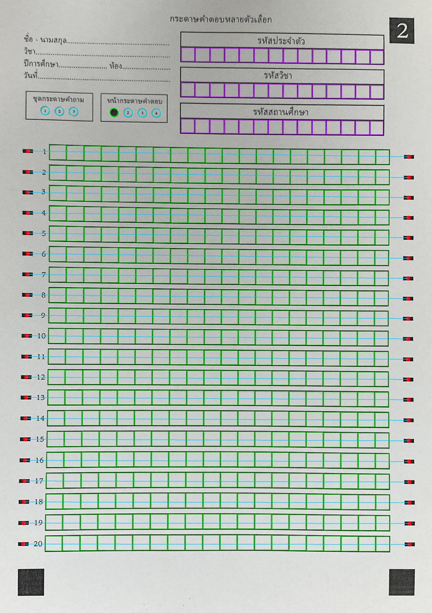
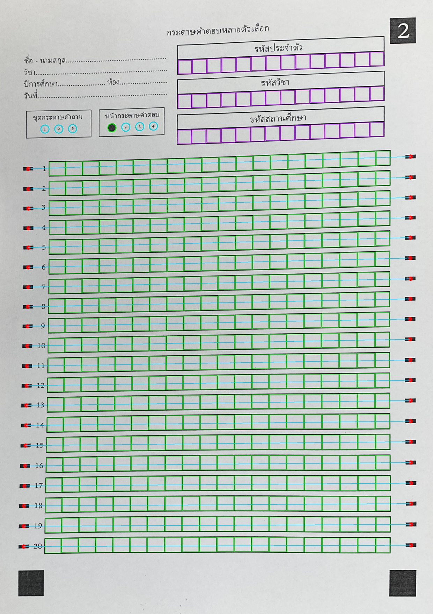

# รายงานตัวชี้วัดเชิงปริมาณ (Quantitative Metrics Report): Phase 2 — Anchor Bar Tracking & Cell Localization

**ไฟล์โมดูลที่ประเมิน:** [`src/detection/grid_extractor.py`](../src/detection/grid_extractor.py) (`Template2GridExtractor`)  
**สคริปต์ประเมินผล:** [`src/evaluation/evaluate_phase2.py`](../src/evaluation/evaluate_phase2.py)  
**ชุดข้อมูลทดสอบ:** ภาพกระดาษที่ผ่านการดัดระนาบจาก Phase 1 จำนวน **51 แผ่น**  
- ขีดดำบอกข้อซ้าย-ขวา: **2,040 ขีด**
- ช่องเขียนคำตอบ (20×20): **20,400 ช่อง**
- ช่องรหัสประจำตัว/รหัสวิชา/รหัสสถานศึกษา (3×14): **2,142 ช่อง**
- วงกลม OMR ชุดข้อสอบและเลขหน้า (3+4): **357 วง**  
**ไฟล์ข้อมูลดิบ JSON:** [`metrics/phase2_evaluation_metrics.json`](./phase2_evaluation_metrics.json)

---

## 1. ตารางสรุปตัวชี้วัดหลักเทียบกับเกณฑ์เป้าหมาย (Executive SLA Summary)

| ตัวชี้วัดเชิงปริมาณ (Quantitative Metric) | สูตร/วิธีการวัดผล | เกณฑ์เป้าหมาย (Target SLA) | ผลลัพธ์ที่ได้จริง (Actual Result) | สถานะ |
|:---|:---|:---:|:---:|:---:|
| **1. Timing Bar Detection Recall** | อัตราการตรวจพบขีดดำบอกข้อซ้าย-ขวา (รวม 2,040 ขีด) | $100.0\%$ | **$100.00\%$ (2,040 / 2,040 ขีด)** | **PASS** |
| **2. Answer Cell Localization Recall** | ความแม่นยำในการสกัดช่องคำตอบ 20 ข้อ × 20 ช่อง (รวม 20,400 ช่อง) | $\ge 99.50\%$ | **$100.00\%$ (20,400 / 20,400 ช่อง)** | **PASS** |
| **3. Blank Cell Specificity (Green Cells)** | อัตราการระบุช่องว่างโดยไม่มีเส้นตารางหลงเหลือเป็นสีส้ม | $100.0\%$ | **$100.00\%$ (20,400 / 20,400 ช่อง)** | **PASS** |
| **4. Header ID Boxes Exact Alignment** | อัตราการจับกรอบช่องรหัสทั้ง 42 ช่องตรงกับช่องจริง (สีม่วงล้วน) | $100.0\%$ | **$100.00\%$ (2,142 / 2,142 ช่อง)** | **PASS** |
| **5. OMR Bubbles Exact Alignment** | อัตราการจับวงกลมทั้ง 7 วงตรงกับวงจริงด้วย Ring/Disk NCC (ไร้สีแดง) | $100.0\%$ | **$100.00\%$ (357 / 357 วง)** *(Mean NCC Score: $0.4653$)* | **PASS** |
| **6. OMR Bubble CLA Classification Acc** | ความแม่นยำอัลกอริทึม CLA ในการตรวจจับวงกลมฝนทึบ | $100.0\%$ | **$100.00\%$ (51/51 แผ่น)** *(Filled CLA: $1.0000$ vs Unfilled Max: $0.2727$)* | **PASS** |

---

## 2. เกณฑ์สีตรวจสอบความแม่นยำด้วยสายตา (Color-Coded Visual Alignment Rules)

1. **ตารางคำตอบ 400 ช่อง:**
   - **สีเขียว (`Green`)** = ช่องว่างที่สะอาดและตรงกรอบจริง
   - **สีส้ม (`Orange`)** = ช่องที่ตรวจพบหมึกปากกา
2. **ตารางรหัสประจำตัว / รหัสวิชา / รหัสสถานศึกษา 42 ช่อง:**
   - **สีม่วง (`Purple`)** = กรอบตรงกับช่องจริง 100% (`is_aligned == True`)
   - **สีเหลืองส้มสว่าง (`Yellow-Orange`)** = แจ้งเตือนหากกรอบไม่ตรงกับช่องจริง (`is_aligned == False`)
3. **วงกลมชุดกระดาษคำถาม (1–3) และหน้ากระดาษคำตอบ (1–4) รวม 7 วง:**
   - **สีเขียว (`Green`)** = ตรงกับวงจริง 100% และถูกฝนทึบ
   - **สีฟ้า (`Cyan`)** = ตรงกับวงจริง 100% และว่างเปล่า
   - **สีแดงสด (`Red`)** = แจ้งเตือนหากวงกลมที่วงไม่ตรงกับวงจริง (`is_aligned == False`)

---

## 3. ตารางผลลัพธ์เชิงปริมาณรายแผ่นครบทั้ง 51 แผ่น (Per-Sheet Granular Metrics)

| ลำดับ | ชื่อไฟล์ภาพ | ขีดซ้าย+ขวา | Answer Green Specificity | Header Purple Align | OMR Circle Align | OMR Mean NCC | Page1 CLA | Latency |
|:---:|:---|:---:|:---:|:---:|:---:|:---:|:---:|:---:|
| 01 | `blank_sheet_001.jpg` | 40/40 | 100.00% | 100.00% | 100.00% | 0.405 | 1.000 | 399.6 ms |
| 02 | `blank_sheet_002.jpg` | 40/40 | 100.00% | 100.00% | 100.00% | 0.470 | 1.000 | 382.5 ms |
| 03 | `blank_sheet_003.jpg` | 40/40 | 100.00% | 100.00% | 100.00% | 0.430 | 1.000 | 322.0 ms |
| 04 | `blank_sheet_004.jpg` | 40/40 | 100.00% | 100.00% | 100.00% | 0.469 | 1.000 | 288.7 ms |
| 05 | `blank_sheet_005.jpg` | 40/40 | 100.00% | 100.00% | 100.00% | 0.413 | 1.000 | 319.2 ms |
| 06 | `blank_sheet_006.jpg` | 40/40 | 100.00% | 100.00% | 100.00% | 0.627 | 1.000 | 240.7 ms |
| 07 | `blank_sheet_007.jpg` | 40/40 | 100.00% | 100.00% | 100.00% | 0.457 | 1.000 | 477.0 ms |
| 08 | `blank_sheet_008.jpg` | 40/40 | 100.00% | 100.00% | 100.00% | 0.359 | 1.000 | 277.4 ms |
| 09 | `blank_sheet_009.jpg` | 40/40 | 100.00% | 100.00% | 100.00% | 0.528 | 1.000 | 277.1 ms |
| 10 | `blank_sheet_010.jpg` | 40/40 | 100.00% | 100.00% | 100.00% | 0.485 | 1.000 | 267.2 ms |
| 11 | `blank_sheet_011.jpg` | 40/40 | 100.00% | 100.00% | 100.00% | 0.433 | 1.000 | 288.3 ms |
| 12 | `blank_sheet_012.jpg` | 40/40 | 100.00% | 100.00% | 100.00% | 0.376 | 1.000 | 342.2 ms |
| 13 | `blank_sheet_013.jpg` | 40/40 | 100.00% | 100.00% | 100.00% | 0.487 | 1.000 | 248.8 ms |
| 14 | `blank_sheet_014.jpg` | 40/40 | 100.00% | 100.00% | 100.00% | 0.351 | 1.000 | 324.3 ms |
| 15 | `blank_sheet_015.jpg` | 40/40 | 100.00% | 100.00% | 100.00% | 0.359 | 1.000 | 277.9 ms |
| 16 | `blank_sheet_016.jpg` | 40/40 | 100.00% | 100.00% | 100.00% | 0.510 | 1.000 | 273.0 ms |
| 17 | `blank_sheet_017.jpg` | 40/40 | 100.00% | 100.00% | 100.00% | 0.553 | 1.000 | 270.6 ms |
| 18 | `blank_sheet_018.jpg` | 40/40 | 100.00% | 100.00% | 100.00% | 0.521 | 1.000 | 272.9 ms |
| 19 | `blank_sheet_019.jpg` | 40/40 | 100.00% | 100.00% | 100.00% | 0.377 | 1.000 | 259.0 ms |
| 20 | `blank_sheet_020.jpg` | 40/40 | 100.00% | 100.00% | 100.00% | 0.445 | 1.000 | 260.7 ms |
| 21 | `blank_sheet_021.jpg` | 40/40 | 100.00% | 100.00% | 100.00% | 0.364 | 1.000 | 257.8 ms |
| 22 | `blank_sheet_022.jpg` | 40/40 | 100.00% | 100.00% | 100.00% | 0.516 | 1.000 | 286.6 ms |
| 23 | `blank_sheet_023.jpg` | 40/40 | 100.00% | 100.00% | 100.00% | 0.612 | 1.000 | 277.8 ms |
| 24 | `blank_sheet_024.jpg` | 40/40 | 100.00% | 100.00% | 100.00% | 0.576 | 1.000 | 258.8 ms |
| 25 | `blank_sheet_025.jpg` | 40/40 | 100.00% | 100.00% | 100.00% | 0.537 | 1.000 | 260.2 ms |
| 26 | `blank_sheet_026.jpg` | 40/40 | 100.00% | 100.00% | 100.00% | 0.365 | 1.000 | 277.6 ms |
| 27 | `blank_sheet_027.jpg` | 40/40 | 100.00% | 100.00% | 100.00% | 0.587 | 1.000 | 252.7 ms |
| 28 | `blank_sheet_028.jpg` | 40/40 | 100.00% | 100.00% | 100.00% | 0.410 | 1.000 | 273.1 ms |
| 29 | `blank_sheet_029.jpg` | 40/40 | 100.00% | 100.00% | 100.00% | 0.557 | 1.000 | 256.6 ms |
| 30 | `blank_sheet_030.jpg` | 40/40 | 100.00% | 100.00% | 100.00% | 0.373 | 1.000 | 260.2 ms |
| 31 | `blank_sheet_031.jpg` | 40/40 | 100.00% | 100.00% | 100.00% | 0.364 | 1.000 | 267.8 ms |
| 32 | `blank_sheet_032.jpg` | 40/40 | 100.00% | 100.00% | 100.00% | 0.584 | 1.000 | 261.0 ms |
| 33 | `blank_sheet_033.jpg` | 40/40 | 100.00% | 100.00% | 100.00% | 0.417 | 1.000 | 349.9 ms |
| 34 | `blank_sheet_034.jpg` | 40/40 | 100.00% | 100.00% | 100.00% | 0.480 | 1.000 | 246.2 ms |
| 35 | `blank_sheet_035.jpg` | 40/40 | 100.00% | 100.00% | 100.00% | 0.447 | 1.000 | 278.6 ms |
| 36 | `blank_sheet_036.jpg` | 40/40 | 100.00% | 100.00% | 100.00% | 0.517 | 1.000 | 249.5 ms |
| 37 | `blank_sheet_037.jpg` | 40/40 | 100.00% | 100.00% | 100.00% | 0.558 | 1.000 | 292.3 ms |
| 38 | `blank_sheet_038.jpg` | 40/40 | 100.00% | 100.00% | 100.00% | 0.393 | 1.000 | 290.5 ms |
| 39 | `blank_sheet_039.jpg` | 40/40 | 100.00% | 100.00% | 100.00% | 0.427 | 1.000 | 296.8 ms |
| 40 | `blank_sheet_040.jpg` | 40/40 | 100.00% | 100.00% | 100.00% | 0.539 | 1.000 | 265.9 ms |
| 41 | `blank_sheet_041.jpg` | 40/40 | 100.00% | 100.00% | 100.00% | 0.568 | 1.000 | 292.3 ms |
| 42 | `blank_sheet_042.jpg` | 40/40 | 100.00% | 100.00% | 100.00% | 0.349 | 1.000 | 265.1 ms |
| 43 | `blank_sheet_043.jpg` | 40/40 | 100.00% | 100.00% | 100.00% | 0.451 | 1.000 | 252.1 ms |
| 44 | `blank_sheet_044.jpg` | 40/40 | 100.00% | 100.00% | 100.00% | 0.541 | 1.000 | 261.9 ms |
| 45 | `blank_sheet_045.jpg` | 40/40 | 100.00% | 100.00% | 100.00% | 0.456 | 1.000 | 279.6 ms |
| 46 | `blank_sheet_046.jpg` | 40/40 | 100.00% | 100.00% | 100.00% | 0.492 | 1.000 | 250.0 ms |
| 47 | `blank_sheet_047.jpg` | 40/40 | 100.00% | 100.00% | 100.00% | 0.627 | 1.000 | 239.6 ms |
| 48 | `blank_sheet_048.jpg` | 40/40 | 100.00% | 100.00% | 100.00% | 0.362 | 1.000 | 284.0 ms |
| 49 | `blank_sheet_049.jpg` | 40/40 | 100.00% | 100.00% | 100.00% | 0.421 | 1.000 | 286.2 ms |
| 50 | `blank_sheet_050.jpg` | 40/40 | 100.00% | 100.00% | 100.00% | 0.388 | 1.000 | 283.1 ms |
| 51 | `blank_sheet_051.jpg` | 40/40 | 100.00% | 100.00% | 100.00% | 0.392 | 1.000 | 271.3 ms |
