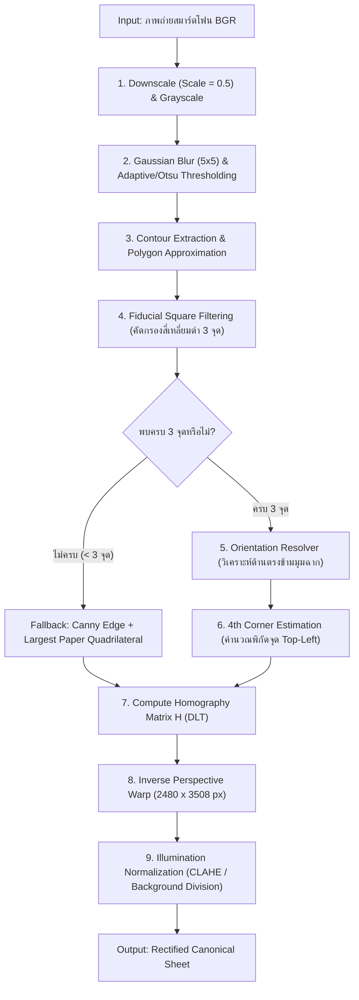

# Phase 1: Preprocessing & Fiducial Dewarping
**ไฟล์โมดูลเป้าหมาย:** `src/preprocessing/dewarp.py`  
**อ้างอิงทฤษฎี:** *Automated Optical Marker Exam Recognition (SNPD 2025)* และ *DocUNet (CVPR 2018)*

---

## 1. วัตถุประสงค์และขอบเขตการทำงาน (Objective & Scope)
ในสภาพแวดล้อมการใช้งานจริง ครูหรือผู้ตรวจจะใช้กล้องสมาร์ตโฟนถ่ายภาพกระดาษคำตอบ **Template 2** ซึ่งก่อให้เกิดความท้าทายหลัก 4 ประการ:
1. **Perspective Distortion:** มุมกล้องไม่ได้ตั้งฉาก $90^\circ$ กับระนาบกระดาษ ทำให้กระดาษมีลักษณะเป็นสี่เหลี่ยมคางหมูหรือสี่เหลี่ยมด้านไม่เท่า
2. **Arbitrary Rotation:** ภาพอาจถูกถ่ายในแนวตั้ง แนวนอน หรือกลับหัว ($0^\circ, 90^\circ, 180^\circ, 270^\circ$) รวมถึงการเอียงเล็กน้อย ($\pm 15^\circ$)
3. **Non-uniform Illumination:** แสงเงาจากหลอดไฟหรือเงาของมือผู้ถ่ายพาดผ่านกระดาษ
4. **Varying Resolution:** กล้องแต่ละรุ่นมีความละเอียดและสัดส่วนภาพแตกต่างกัน

**เป้าหมายของ Phase 1:** ดัดระนาบภาพถ่ายทุกใบให้กลับมาเป็นภาพมุมมองตรงจากด้านบน (Top-Down Rectified View) ที่มีขนาดมาตรฐาน **$2480 \times 3508$ พิกเซล (เทียบเท่า A4 ที่ 300 DPI)** และหมุนตั้งตรงถูกต้อง $100\%$ ภายในเวลาประมวลผลไม่เกิน $35\text{ ms}$

---

## 2. ลำดับขั้นตอนของอัลกอริทึม (Algorithmic Pipeline)



---

## 3. รายละเอียดทางคณิตศาสตร์และการคำนวณเชิงลึก

### 3.1 การตรวจจับหมุดสี่เหลี่ยมดำ 3 มุม (3 Fiducial Corner Markers Detection)
จากการวิเคราะห์โครงสร้างจริงของกระดาษคำตอบ **Template 2** (`template2_1_1.jpg` ขนาด $2480 \times 3508$ px) พบว่ามีจุดมาร์กเกอร์สี่เหลี่ยมทึบสีดำขนาดใหญ่จำนวน **3 จุด** (ไม่มีจุดที่มุมบนซ้าย เพื่อใช้ระบุทิศทางกระดาษ):
- **มุมบนขวา (Top-Right: $TR$):** พิกัด $(2232, 100)$, ขนาด $150 \times 151\text{ px}$, พื้นที่ $\approx 22,350\text{ px}^2$
- **มุมล่างซ้าย (Bottom-Left: $BL$):** พิกัด $(103, 3257)$, ขนาด $150 \times 151\text{ px}$, พื้นที่ $\approx 22,350\text{ px}^2$
- **มุมล่างขวา (Bottom-Right: $BR$):** พิกัด $(2232, 3257)$, ขนาด $150 \times 151\text{ px}$, พื้นที่ $\approx 22,350\text{ px}^2$

#### เกณฑ์การคัดกรอง Contour (Geometric Invariants Filtering):
สำหรับคอนทัวร์ $C_i$ ใดๆ ที่ได้จากการทำ Binary Inversion Thresholding:
1. **การประมาณค่าหลายเหลี่ยม (Douglas-Peucker Approximation):**
   $$\text{Poly}_i = \text{approxPolyDP}(C_i, \epsilon = 0.04 \times \text{Perimeter}(C_i))$$
   ต้องมีจำนวนจุดยอด $|\text{Poly}_i| = 4$ และเป็นรูปนูน (`isContourConvex == True`)
2. **สัดส่วนพื้นที่สัมพัทธ์ (Relative Area Constraint):**
   เมื่อเทียบกับพื้นที่ภาพทั้งหมด $A_{\text{img}} = W \times H$:
   $$0.0015 \le \frac{\text{Area}(C_i)}{A_{\text{img}}} \le 0.0060$$
3. **อัตราส่วนกว้างยาวและความทึบ (Aspect Ratio & Solidity):**
   $$0.80 \le \frac{w_i}{h_i} \le 1.25 \quad \text{และ} \quad \text{Solidity} = \frac{\text{Area}(C_i)}{\text{ConvexHullArea}(C_i)} \ge 0.90$$
4. **ความเข้มมืดภายใน (Internal Intensity Check):**
   ค่าเฉลี่ยความสว่างของพิกเซลภายในคอนทัวร์ $\mu_{\text{inside}} < 80$ (จากระดับ 0–255) เพื่อป้องกันการจำสับสนกับกรอบตารางว่าง

---

### 3.2 การระบุทิศทางการหมุนและการจัดเรียงพิกัด (Orientation Resolution via Hypotenuse Analysis)
เมื่อได้จุดศูนย์กลางมวล (Centroid) ของมาร์กเกอร์ทั้ง 3 จุด คือ $\mathbf{P}_1, \mathbf{P}_2, \mathbf{P}_3 \in \mathbb{R}^2$:

1. **หาด้านตรงข้ามมุมฉาก (Hypotenuse Identification):**
   คำนวณระยะทางยุคลิดกำลังสองระหว่างทุกคู่จุด:
   $$d_{12}^2 = \|\mathbf{P}_1 - \mathbf{P}_2\|^2, \quad d_{23}^2 = \|\mathbf{P}_2 - \mathbf{P}_3\|^2, \quad d_{31}^2 = \|\mathbf{P}_3 - \mathbf{P}_1\|^2$$
   คู่จุดที่มีระยะห่างมากที่สุดคือคู่ปลายของเส้นทแยงมุม **(Top-Right และ Bottom-Left)** ส่วนจุดที่เหลืออยู่ตรงข้ามด้านที่ยาวที่สุดคือจุดมุมฉาก **Bottom-Right ($\mathbf{P}_{BR}$)** เสมอ!

2. **การแยกแยะระหว่างจุด Top-Right ($\mathbf{P}_{TR}$) กับ Bottom-Left ($\mathbf{P}_{BL}$):**
   ใช้ผลคูณไขว้ 2 มิติ (2D Cross Product / Determinant) ของเวกเตอร์ที่พุ่งออกจากจุดมุมฉาก $\mathbf{P}_{BR}$ ไปยังอีกสองจุดที่เหลือ สมมติให้คือ $\mathbf{A}$ และ $\mathbf{B}$:
   $$\mathbf{v}_A = \mathbf{A} - \mathbf{P}_{BR}, \quad \mathbf{v}_B = \mathbf{B} - \mathbf{P}_{BR}$$
   $$\det(\mathbf{v}_A, \mathbf{v}_B) = v_{A,x} v_{B,y} - v_{A,y} v_{B,x}$$
   ในระบบพิกัดภาพมาตรฐาน (แกน $X$ ชี้ขวา, แกน $Y$ ชี้ลงล่าง):
   - เวกเตอร์ที่ชี้จาก $BR \to BL$ ไปยัง $BR \to TR$ จะหมุนตามเข็มนาฬิกา
   - หาก $\det(\mathbf{v}_A, \mathbf{v}_B) > 0$: จะได้ $\mathbf{A} = \mathbf{P}_{BL}$ และ $\mathbf{B} = \mathbf{P}_{TR}$
   - หาก $\det(\mathbf{v}_A, \mathbf{v}_B) < 0$: จะได้ $\mathbf{A} = \mathbf{P}_{TR}$ และ $\mathbf{B} = \mathbf{P}_{BL}$

> **ข้อได้เปรียบเชิงวิศวกรรม:** วิธี Cross Product นี้ทำงานได้ถูกต้อง $100\%$ ไม่ว่าภาพจะหมุนไปที่มุมใดๆ ใน $360^\circ$ โดยไม่ต้องหมุนภาพไปลองตรวจทีละ 90 องศา!

---

### 3.3 การประมาณจุดมุมที่ 4 (Top-Left Corner Estimation) และการปรับแต่ง Sub-pixel
เมื่อทราบจุดศูนย์กลางของมาร์กเกอร์ $\mathbf{P}_{TR}, \mathbf{P}_{BL}, \mathbf{P}_{BR}$:
1. **การคำนวณจุดศูนย์กลาง $\mathbf{P}_{TL}$ เบื้องต้นด้วยกฎสี่เหลี่ยมด้านขนาน (Parallelogram Law):**
   $$\mathbf{P}_{TL}^{\text{init}} = \mathbf{P}_{TR} + \mathbf{P}_{BL} - \mathbf{P}_{BR}$$
2. **การชดเชยความบิดเบี้ยวเชิงทัศนมิติ (Perspective Foreshortening Refinement):**
   หากภาพถ่ายเอียงมาก สี่เหลี่ยมจะกลายเป็นสี่เหลี่ยมคางหมู เราใช้จุดยอดมุมทั้ง 4 ของมาร์กเกอร์แต่ละตัว (รวม $3 \times 4 = 12$ จุดย่อย) เพื่อหาจุดตัดของเส้นขอบบน (จากขอบบนของมาร์กเกอร์ $TR$) และเส้นขอบซ้าย (จากขอบซ้ายของมาร์กเกอร์ $BL$) ด้วยสมการเส้นตรงในพิกัดโฮโมจีเนียส (Homogeneous Coordinates):
   $$\mathbf{l}_{\text{top}} = \mathbf{p}_{TR,\text{tl}} \times \mathbf{p}_{TR,\text{tr}}, \quad \mathbf{l}_{\text{left}} = \mathbf{p}_{BL,\text{tl}} \times \mathbf{p}_{BL,\text{bl}}$$
   $$\mathbf{P}_{TL}^{\text{exact}} = \mathbf{l}_{\text{top}} \times \mathbf{l}_{\text{left}}$$
   *(ทำให้ได้พิกัดจุดมุมที่ 4 ที่แม่นยำแม้ถ่ายด้วยมุมเอียงสูงสุดถึง $45^\circ$)*

---

### 3.4 การแปลงระนาบโฮโมกราฟี (Projective Homography Warping)
จับคู่พิกัดมาร์กเกอร์จากภาพถ่าย $\mathbf{P}_{\text{src}} = \{\mathbf{P}_{TL}, \mathbf{P}_{TR}, \mathbf{P}_{BR}, \mathbf{P}_{BL}\}$ ไปยังพิกัดจุดศูนย์กลางมาร์กเกอร์มาตรฐานบนภาพแม่แบบขนาด $2480 \times 3508$:
$$\mathbf{P}_{\text{dst}} = \begin{bmatrix} 178.0 & 175.5 \\ 2307.0 & 175.5 \\ 2307.0 & 3332.5 \\ 178.0 & 3332.5 \end{bmatrix}$$
คำนวณเมทริกซ์ $\mathbf{H} \in \mathbb{R}^{3 \times 3}$ ด้วย Direct Linear Transformation (DLT) และทำ Inverse Mapping ด้วย Bilinear Interpolation (`cv2.INTER_LINEAR`)

---

### 3.5 การปรับสมดุลแสงเงา (Illumination Normalization)
เพื่อกำจัดเงามือหรือแสงไฟที่ไม่สม่ำเสมอก่อนส่งต่อให้ Phase 2–4:
1. ประมาณภาพพื้นหลัง (Background Illumination Map $I_{\text{bg}}$) ด้วย Morphological Closing หรือ Median Filter ขนาดใหญ่ ($51 \times 51\text{ px}$)
2. ทำการหารปรับความสว่าง (Background Division Normalization):
   $$I_{\text{norm}}(x, y) = \min\left(255, \frac{I_{\text{gray}}(x, y)}{I_{\text{bg}}(x, y) + \epsilon} \times 255\right)$$

---

## 4. โครงสร้างโค้ดและการออกแบบคลาส (Implementation Blueprint)

```python
# src/preprocessing/dewarp.py
import cv2
import numpy as np
from dataclasses import dataclass
from typing import Tuple, Dict, Optional

@dataclass
class DewarpResult:
    rectified_image: np.ndarray
    homography_matrix: np.ndarray
    detected_corners: Dict[str, Tuple[float, float]]
    rotation_angle_deg: float
    reprojection_rmse: float
    processing_time_ms: float
    used_fallback: bool

class FiducialDewarper:
    CANONICAL_WIDTH = 2480
    CANONICAL_HEIGHT = 3508
    # พิกัดจุดศูนย์กลางของ Fiducial Markers บน Template 2 มาตรฐาน
    CANONICAL_CENTERS = np.array([
        [178.0, 175.5],   # Top-Left (virtual)
        [2307.0, 175.5],  # Top-Right
        [2307.0, 3332.5], # Bottom-Right
        [178.0, 3332.5]   # Bottom-Left
    ], dtype=np.float32)

    def __init__(self, min_area_ratio=0.0012, max_area_ratio=0.0065):
        self.min_area_ratio = min_area_ratio
        self.max_area_ratio = max_area_ratio

    def resolve_three_markers(self, pts: np.ndarray) -> np.ndarray:
        """
        จัดเรียงจุด 3 จุดให้เป็น [TL, TR, BR, BL] โดยใช้ Hypotenuse & 2D Cross Product
        """
        # คำนวณระยะทางกำลังสองของทุกคู่
        d01 = np.sum((pts[0] - pts[1]) ** 2)
        d12 = np.sum((pts[1] - pts[2]) ** 2)
        d20 = np.sum((pts[2] - pts[0]) ** 2)

        dists = [d12, d20, d01] # ด้านตรงข้ามกับจุด 0, 1, 2 ตามลำดับ
        br_idx = int(np.argmax(dists))
        other_indices = [i for i in range(3) if i != br_idx]

        p_br = pts[br_idx]
        p_a, p_b = pts[other_indices[0]], pts[other_indices[1]]

        # Cross product เพื่อแยก TR และ BL
        v_a = p_a - p_br
        v_b = p_b - p_br
        cross = v_a[0] * v_b[1] - v_a[1] * v_b[0]

        if cross > 0:
            p_bl, p_tr = p_a, p_b
        else:
            p_tr, p_bl = p_a, p_b

        p_tl = p_tr + p_bl - p_br
        return np.array([p_tl, p_tr, p_br, p_bl], dtype=np.float32)
```

---

## 5. ตัวชี้วัดเชิงปริมาณและเกณฑ์การผ่าน (Quantitative Metrics & Verification)

ในการรันทดสอบทุกครั้ง โมดูลจะต้องคำนวณและบันทึกตัวชี้วัดตัวเลขดังต่อไปนี้:

### 5.1 Keypoint Reprojection RMSE (Root Mean Square Error)
วัดความคลาดเคลื่อนหลังการแปลงระนาบเทียบกับพิกัดจริงบนแม่แบบ:
$$\text{RMSE} = \sqrt{\frac{1}{3} \sum_{k \in \{TR, BR, BL\}} \|\tilde{\mathbf{P}}_k - \mathbf{P}_k^{\text{canonical}}\|_2^2}$$
- **เกณฑ์เป้าหมาย (Target):** $\text{RMSE} \le 3.0\text{ pixels}$

### 5.2 Document Boundary IoU (Intersection over Union)
วัดพื้นที่ซ้อนทับของขอบกระดาษหลัง Dewarp เทียบกับ Ground Truth Mask:
$$\text{IoU} = \frac{|\text{Mask}_{\text{pred}} \cap \text{Mask}_{\text{gt}}|}{|\text{Mask}_{\text{pred}} \cup \text{Mask}_{\text{gt}}|}$$
- **เกณฑ์เป้าหมาย (Target):** $\text{IoU} \ge 0.95$

### 5.3 Orientation Classification Accuracy
ทดสอบด้วยการสุ่มหมุนภาพใน `data/raw/blank_papers/` จำนวน 51 ภาพ เป็นมุม $0^\circ, 90^\circ, 180^\circ, 270^\circ$ และมุมเอียงสุ่ม $\pm 20^\circ$ (รวม 204 ภาพทดสอบ):
- **เกณฑ์เป้าหมาย (Target):** Accuracy = $100.0\%$

### 5.4 Processing Latency
วัดเวลาเฉลี่ยต่อภาพ (Mean $\pm$ SD และ 95th Percentile):
- **เกณฑ์เป้าหมาย (Target):** $\le 35\text{ ms/image}$ บน CPU มาตรฐาน
