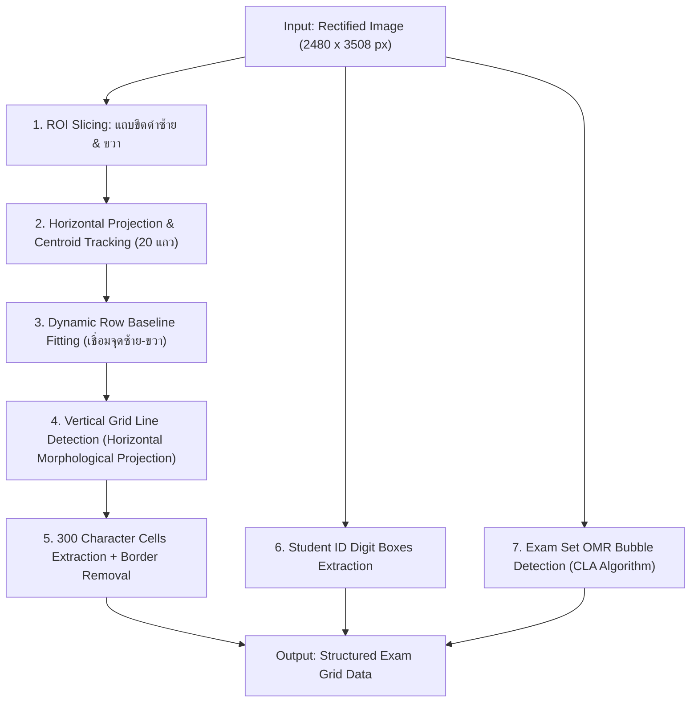

# Phase 2: Anchor Bar Tracking & Cell Localization
**ไฟล์โมดูลเป้าหมาย:** `src/detection/grid_extractor.py`  
**อ้างอิงทฤษฎี:** *Automated Optical Marker Exam Recognition (SNPD 2025)* และ *CascadeTabNet (CVPRW 2020)*

---

## 1. วัตถุประสงค์และขอบเขตการทำงาน (Objective & Scope)
หลังจากที่ภาพกระดาษคำตอบถูกดัดระนาบให้ตรงด้วยขนาดมาตรฐาน $2480 \times 3508\text{ px}$ ใน Phase 1 แล้ว กระดาษจริงอาจยังคงมีการยืดหดตัวไม่สม่ำเสมอจากการถ่ายเอกสาร หรือเกิดการโก่งตัวเล็กน้อยตรงกลางหน้ากระดาษ (Non-linear local warping) หากใช้การตัดพิกัดแบบตายตัว (Fixed Hardcoded Coordinates) เพียงอย่างเดียว เส้นตารางอาจกินเข้ามาในช่องตัวอักษรได้

**เป้าหมายของ Phase 2:**
1. สแกนหา **ขีดดำบอกตำแหน่งข้อทางด้านซ้ายและขวา (Left & Right Timing / Anchor Bars)** ทั้ง 20 ขีดเพื่อระบุเส้นบรรทัดของข้อ 1–20 อย่างแม่นยำตามสภาพกระดาษจริง
2. สกัดช่องเขียนคำตอบจำนวน **20 ข้อ × 15 ช่องตัวอักษร = 300 ช่อง** พร้อมตัดขอบเส้นตารางสีดำออกอย่างหมดจด
3. สกัดช่อง **รหัสนักเรียน (Student ID Boxes)** และตรวจจับ **วงกลมเลือกชุดข้อสอบ (Exam Set Bubbles)** ด้วยอัลกอริทึม Cross-Linear Area (CLA)

---

## 2. ลำดับขั้นตอนของอัลกอริทึม (Algorithmic Pipeline)



---

## 3. รายละเอียดทางคณิตศาสตร์และการคำนวณเชิงลึก

### 3.1 การตรวจจับขีดดำซ้าย-ขวา (Left & Right Anchor Bars Detection)
จากการวัดพิกัดจริงบนแม่แบบ `template2_1_1.jpg` ($2480 \times 3508$ px):
- ขีดดำบอกบรรทัดมีลักษณะเป็นสี่เหลี่ยมผืนผ้าทึบสีดำขนาดกว้าง $W_{\text{bar}} \approx 60\text{ px}$, สูง $H_{\text{bar}} \approx 22\text{ px}$
- ระยะห่างแนวตั้งระหว่างบรรทัดติดกัน (Row Pitch): $\Delta Y \approx 116\text{ px}$
- พิกัดแนวตั้งตั้งแต่ข้อที่ 1 ถึงข้อที่ 20 อยู่ในช่วง $Y \in [850, 3180]$

#### อัลกอริทึมการสแกนและซ่อมแซมจุดที่หายไป (RANSAC / Linear Interpolation Recovery):
1. ตัด ROI แถบซ้าย $X \in [80, 220]$ และแถบขวา $X \in [2260, 2400]$
2. ทำ Morphological Opening ด้วย Kernel ขนาด $(25, 7)$ เพื่อเก็บเฉพาะขีดดำแนวนอน
3. คำนวณจุดศูนย์กลางมวล $(x_i^L, y_i^L)$ และ $(x_i^R, y_i^R)$ สำหรับ $i \in \{1, \dots, 20\}$
4. **กรณีขีดดำบางข้อเลือนหรือมีรอยนิ้วมือบัง:**
   ใช้สมการถดถอยเชิงเส้น (Linear Regression) บนลำดับดัชนีข้อ $i$:
   $$\hat{y}_i = \beta_0 + \beta_1 \cdot i \quad \text{โดยที่ } \beta_1 \approx 116.0\text{ px}$$
   หากขีดใดหายไปหรือมีค่าคลาดเคลื่อน $|y_i - \hat{y}_i| > 25\text{ px}$ ระบบจะแทนที่ด้วยค่าประมาณการ $\hat{y}_i$ โดยอัตโนมัติ ทำให้ได้ครบ 20 แถวเสมอ $100\%$

---

### 3.2 การคำนวณแนวบรรทัดแบบลาดเอียงไดนามิก (Dynamic Row Baseline Interpolation)
สำหรับข้อสอบข้อที่ $i \in \{1, \dots, 20\}$ ที่ทราบจุดกึ่งกลางขีดซ้าย $(x_i^L, y_i^L)$ และขีดขวา $(x_i^R, y_i^R)$:
- พิกัดแกน $Y$ กึ่งกลางของช่องตัวอักษรที่ตำแหน่งแนวนอน $x$ ใดๆ จะถูกปรับตามความลาดเอียงจริงของบรรทัดนั้น:
  $$y_i^{\text{center}}(x) = y_i^L + \frac{y_i^R - y_i^L}{x_i^R - x_i^L} \cdot (x - x_i^L)$$
- ความสูงของช่องคำตอบในแถวที่ $i$ คำนวณจากระยะห่างระหว่างบรรทัด:
  $$H_{\text{cell}} = \text{round}(0.78 \times \Delta Y) \approx 90\text{ px}$$

---

### 3.3 การแบ่งคอลัมน์ 15 ช่องตัวอักษรและการตัดเส้นขอบตาราง (Column Slicing & Border Cleaning)
ในแต่ละแถวของข้อสอบ Template 2 มีตารางคำตอบเรียงติดกัน **15 ช่อง** (สำหรับเติมคำศัพท์ภาษาอังกฤษสูงสุด 15 ตัวอักษร):
1. **การหาแนวเส้นแบ่งคอลัมน์ (Vertical Grid Line Verification):**
   - ใช้ Vertical Projection Profile ของภาพไบนารีในช่วงตารางคำตอบ เพื่อล็อกตำแหน่งเส้นตั้งทั้ง 16 เส้น ($x_0, x_1, \dots, x_{15}$)
   - สำหรับช่องที่ $j \in \{0, \dots, 14\}$ จะมีขอบเขตแนวนอนคือ $[x_j, x_{j+1}]$
2. **การตัดขอบใน (Inner Margin Cropping & Border Removal):**
   - หดกรอบเข้าด้านใน (Shrink Margin) ด้านละ $m = 6\text{ px}$ เพื่อหลีกเลี่ยงเส้นตารางพิมพ์
   - **Connected Component Border Erase:** ลบ Connected Components สีดำที่มีจุดสัมผัสกับขอบทั้ง 4 ด้านของ Patch ย่อย และมีความยาวเกิน $65\%$ ของความสูง/ความกว้างช่อง เพื่อป้องกันไม่ให้เส้นตารางที่หลงเหลือรบกวนขั้นตอนตรวจขีดฆ่าและ CNN

---

### 3.4 การอ่านวงกลมเลือกชุดข้อสอบด้วย Cross-Linear Area (CLA Algorithm)
อ้างอิงจากงานวิจัย *SNPD 2025* แทนที่จะนับพิกเซลทั้งวงกลมซึ่งไวต่อเงาพาดผ่าน เราสร้างหน้ากากกากบาท (Cross-Linear Mask $\mathcal{P}_{\text{cross}}$) ตัดผ่านจุดศูนย์กลางวงกลม $(c_x, c_y)$ ด้วยความหนาแขนกากบาท $2r_{\text{arm}} + 1$:
$$\text{Fill Ratio}_k = \frac{\sum_{(x, y) \in \mathcal{P}_{\text{cross}}^{(k)}} \mathbb{I}\left(I_{\text{norm}}(x, y) < \tau_{\text{dark}}\right)}{|\mathcal{P}_{\text{cross}}^{(k)}|}$$
- วงกลมชุดข้อสอบ $k^*$ ที่มีค่า $\text{Fill Ratio}_{k^*} \ge 0.45$ และสูงที่สุดจะถูกระบุเป็นชุดเฉลยที่ต้องใช้ตรวจ

---

## 4. โครงสร้างโค้ดและการออกแบบคลาส (Implementation Blueprint)

```python
# src/detection/grid_extractor.py
import cv2
import numpy as np
from dataclasses import dataclass
from typing import List, Dict, Tuple

@dataclass
class CellPatch:
    question_idx: int      # 1 ถึง 20
    char_idx: int          # 0 ถึง 14 (ช่องที่ 1 ถึง 15)
    bbox: Tuple[int, int, int, int] # (x1, y1, x2, y2) บนภาพ Rectified
    image: np.ndarray      # ภาพ Grayscale ของช่องที่ตัดเส้นขอบออกแล้ว
    ink_ratio: float       # สัดส่วนหมึกภายในช่อง (ใช้แยกช่องว่างเปล่า)

class Template2GridExtractor:
    NUM_QUESTIONS = 20
    MAX_CHARS_PER_QUESTION = 15
    INNER_MARGIN_PX = 6
    EMPTY_CELL_INK_THRESHOLD = 0.008  # หากหมึกน้อยกว่า 0.8% ถือว่าเป็นช่องว่าง

    def extract_all_cells(self, rectified_img: np.ndarray) -> List[List[CellPatch]]:
        """
        สกัดช่องคำตอบทั้ง 20 ข้อ x 15 ช่อง พร้อมกรองช่องว่างเบื้องต้น
        """
        pass
```

---

## 5. ตัวชี้วัดเชิงปริมาณและเกณฑ์การผ่าน (Quantitative Metrics & Verification)

### 5.1 Timing Bar Detection Recall & Precision
$$\text{Recall}_{\text{bar}} = \frac{\text{จำนวนขีดบอกข้อที่ตรวจพบถูกต้อง}}{20 \times N_{\text{sheets}}}$$
- **เกณฑ์เป้าหมาย (Target):** $\text{Recall} = 100.0\%$ (หลังผ่านโมดูล Linear Interpolation Recovery)

### 5.2 Answer Cell Bounding Box IoU & mAP@50
เปรียบเทียบพิกัดกรอบช่องทั้ง 300 ช่องที่สกัดได้กับ Ground Truth Template Coordinates:
$$\text{Mean Cell IoU} = \frac{1}{300} \sum_{i=1}^{20} \sum_{j=1}^{15} \text{IoU}(B_{i,j}^{\text{pred}}, B_{i,j}^{\text{gt}})$$
- **เกณฑ์เป้าหมาย (Target):** $\text{Mean Cell IoU} \ge 0.92$, $\text{mAP@50} \ge 99.5\%$

### 5.3 Empty vs. Written Cell Separation Accuracy
วัดความแม่นยำในการคัดกรองช่องว่างเปล่า (Blank Cell) ออกจากช่องที่มีตัวอักษรหรือรอยขีดฆ่า:
- **เกณฑ์เป้าหมาย (Target):** Accuracy $\ge 99.8\%$ (ช่วยลดภาระการรันโมเดล CNN ในช่องที่ไม่มีตัวอักษรได้มากกว่า $60\%$)
