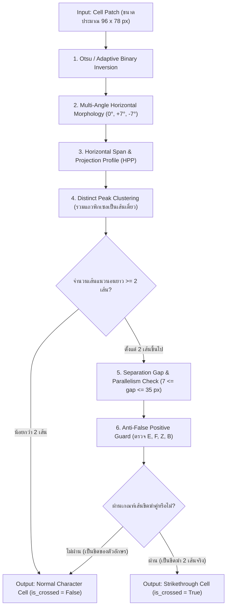

# Phase 3: Double Strikethrough Detection Filter ('=')
**ไฟล์โมดูลเป้าหมาย:** `src/recognition/strikethrough_detector.py`  
**อ้างอิงทฤษฎี:** *OMRNet (MTAP 2024)*, *Cross-Linear Area Detection (SNPD 2025)* และเกณฑ์การตรวจข้อสอบ Rayong MARCO

---

## 1. วัตถุประสงค์และขอบเขตการทำงาน (Objective & Scope)
ตามเกณฑ์การตรวจของโครงการ Rayong MARCO (แต่เดิมใช้การขีดฆ่าเส้นเดียว และ **อัปเกรดเป็นกฎการขีดฆ่าด้วยเส้นแนวนอน 2 เส้นคู่ขนาน `=` ทับตัวอักษรที่ต้องการยกเลิก**):
- หากนักเรียนเขียนผิดในช่องใด สามารถขีดฆ่าทับด้วย **เส้นแนวนอน 2 เส้น** แล้วเขียนตัวอักษรที่ถูกต้องในช่องถัดไปได้ เช่น `[A][P][P][L][E][=D=]` จะต้องอ่านค่าเป็น `"APPLE"`
- **ความท้าทายสำคัญที่สุด:** ตัวอักษรภาษาอังกฤษพิมพ์ใหญ่หลายตัวมีองค์ประกอบของเส้นแนวนอนอยู่แล้ว ได้แก่:
  - ตัวที่มีขีดแนวนอน 3 เส้น: **`E`**
  - ตัวที่มีขีดแนวนอน 2 เส้น: **`F`**, **`Z`**, **`B`**
  - ตัวที่มีขีดแนวนอน 1 เส้นกลาง/บน: **`H`**, **`A`**, **`T`**, **`G`**, **`L`**

**เป้าหมายของ Phase 3:** จำแนกช่องที่มี **การขีดฆ่า 2 เส้น (`=`)** ออกจากตัวอักษรปกติด้วยความแม่นยำ $\ge 96\%$ และมีอัตราการตรวจจับผิดพลาดบนตัวอักษรปกติ (False Positive Rate) $\le 1.5\%$

---

## 2. ลำดับขั้นตอนของอัลกอริทึม (Algorithmic Pipeline)



---

## 3. รายละเอียดทางคณิตศาสตร์และการคำนวณเชิงลึก

### 3.1 การสกัดเส้นแนวนอนที่รองรับการขีดเอียงเล็กน้อย (Multi-Angle Morphological Extraction)
ในการขีดฆ่าจริงด้วยมือ นักเรียนอาจไม่ได้ลากเส้นขนานกับขอบกระดาษเป๊ะ $0^\circ$ แต่อาจเอียงเล็กน้อย ($\pm 8^\circ$)  
ให้ภาพไบนารีผกผันของช่องตัวอักษรคือ $I_{\text{bin}} \in \{0, 1\}^{H \times W}$:
1. กำหนดความยาวขั้นต่ำของเส้นขีดฆ่าสัมพัทธ์กับความกว้างช่อง $W$:
   $$K_w = \max(14, \lfloor \alpha_{\text{span}} \cdot W \rfloor) \quad \text{โดยที่ } \alpha_{\text{span}} = 0.45$$
2. สร้าง Structuring Elements 3 มุม คือ $K_{0^\circ}$ (แนวนอนตรง) และ Kernel เส้นเอียงเล็กน้อย $K_{+7^\circ}, K_{-7^\circ}$
3. สกัดภาพเส้นแนวนอนรวม:
   $$I_{\text{horiz}} = (I_{\text{bin}} \circ K_{0^\circ}) \cup (I_{\text{bin}} \circ K_{+7^\circ}) \cup (I_{\text{bin}} \circ K_{-7^\circ})$$

---

### 3.2 การวิเคราะห์ Horizontal Projection Profile (HPP) และการจับกลุ่มเส้น
1. คำนวณความหนาแน่นของพิกเซลเส้นแนวนอนในแต่ละแถว $y \in \{0, \dots, H-1\}$:
   $$\text{HPP}(y) = \frac{1}{W} \sum_{x=0}^{W-1} I_{\text{horiz}}(y, x)$$
2. คัดกรองแถวที่มีความหนาแน่นเกินเกณฑ์ $\tau_{\text{density}} = 0.45$:
   $$\mathcal{R} = \{ y \mid \text{HPP}(y) \ge \tau_{\text{density}} \}$$
3. จัดกลุ่มแถวที่ติดกัน (Connected Row Intervals) เป็นเส้นเดี่ยว $L_k = [y_k^{\text{start}}, y_k^{\text{end}}]$ พร้อมคำนวณคุณสมบัติของแต่ละเส้น:
   - จุดกึ่งกลางแนวตั้ง: $c_k = \frac{1}{2}(y_k^{\text{start}} + y_k^{\text{end}})$
   - ความหนาของเส้น: $t_k = y_k^{\text{end}} - y_k^{\text{start}} + 1$ (กรองเฉพาะ $1 \le t_k \le 14\text{ px}$)
   - ความกว้างจริงจากปลายซ้ายสุดถึงขวาสุด: $s_k = x_k^{\text{max}} - x_k^{\text{min}}$

---

### 3.3 เงื่อนไขการจับคู่เส้นขนาน 2 เส้น (Double-Line Pairing Criteria)
สำหรับคู่เส้นแนวนอน $(L_a, L_b)$ ใดๆ โดยที่ $c_b > c_a$:
1. **ระยะห่างระหว่างเส้น (Inter-line Separation Gap):**
   $$\Delta y_{ab} = c_b - c_a \in [d_{\min}, d_{\max}] \quad (\text{ค่ามาตรฐาน } d_{\min} = 6\text{ px}, d_{\max} = 35\text{ px})$$
2. **ความสอดคล้องของตำแหน่งแนวนอน (Horizontal Overlap Ratio):**
   เส้นขีดฆ่าทั้ง 2 เส้นต้องวางซ้อนทับกันตามแนวนอนอย่างน้อย $70\%$:
   $$\text{Overlap}(L_a, L_b) = \frac{\min(x_a^{\text{max}}, x_b^{\text{max}}) - \max(x_a^{\text{min}}, x_b^{\text{min}})}{\max(s_a, s_b)} \ge 0.70$$

---

### 3.4 กลไกป้องกันการตรวจพลาดในตัวอักษร `E`, `F`, `Z`, `B` (Anti-False Positive Guard)
นี่คือส่วนที่ทำให้ระบบมีความแม่นยำเหนือกว่าระบบพื้นฐาน โดยใช้คุณลักษณะทางเรขาคณิต 3 ข้อในการแยกแยะตัวอักษรออกจากรอยขีดฆ่า:

| คุณลักษณะ (Feature) | ตัวอักษร `E`, `F`, `B`, `Z` | การขีดฆ่า 2 เส้นทับตัวอักษร (`=`) |
|:---|:---|:---|
| **1. Relative Span Ratio ($s_k / W_{\text{ink}}$)** | ขีดของ `E`, `F` มีความยาวเท่ากับความกว้างของตัวอักษรพอดี (ไม่ยื่นทะลุซ้าย-ขวา) | เส้นขีดฆ่ามักลากยาวทะลุขอบซ้ายและขวาของตัวอักษร ($s_k > 1.15 \times W_{\text{char\_core}}$) |
| **2. Vertical Position Distribution** | ในตัว `F` และ `Z` ขีดหนึ่งจะอยู่ที่ขอบบนสุดหรือขอบล่างสุดของตัวอักษร | เส้นขีดฆ่าทั้ง 2 เส้นมักพาดผ่านโซนกลางช่อง ($0.20 H \le c_k \le 0.85 H$) |
| **3. Left Vertical Stem Alignment** | ในตัว `E`, `F`, `B` จุดเริ่มต้นทางซ้ายสุดของเส้นแนวนอน ($x_k^{\text{min}}$) จะชนกับเส้นแกนตั้งทางซ้ายพอดี (ไม่ยื่นล้ำไปทางซ้ายของเส้นตั้ง) | เส้นขีดฆ่าจะยื่นล้ำออกไปทางซ้ายของเส้นแกนตั้งตัวอักษร ($\text{Left Overhang} \ge 4\text{ px}$) |

#### สมการคะแนนความมั่นใจของการขีดฆ่า 2 เส้น (Strikethrough Confidence Score):
$$S_{\text{strike}} = 0.40 \cdot \tilde{S}_{\text{span}} + 0.30 \cdot \tilde{S}_{\text{overlap}} + 0.30 \cdot \tilde{S}_{\text{overhang}}$$
ตัดสินเป็น `is_crossed = True` เมื่อมีคู่เส้นที่ผ่านเกณฑ์ระยะห่างและมีค่า $S_{\text{strike}} \ge 0.55$

---

## 4. โครงสร้างโค้ดและการออกแบบคลาส (Implementation Blueprint)

```python
# src/recognition/strikethrough_detector.py
import cv2
import numpy as np
from typing import Tuple, Dict, List

class DoubleLineStrikeDetector:
    def __init__(
        self,
        min_span_ratio: float = 0.45,
        min_density: float = 0.45,
        min_sep: int = 6,
        max_sep: int = 35,
        confidence_threshold: float = 0.55
    ):
        self.min_span_ratio = min_span_ratio
        self.min_density = min_density
        self.min_sep = min_sep
        self.max_sep = max_sep
        self.confidence_threshold = confidence_threshold

    def check_cell(self, cell_crop: np.ndarray) -> Tuple[bool, Dict]:
        """
        คืนค่า (is_crossed: bool, details: dict) พร้อมคะแนน confidence เชิงตัวเลข
        """
        pass
```

---

## 5. ตัวชี้วัดเชิงปริมาณและเกณฑ์การผ่าน (Quantitative Metrics & Verification)

เพื่อพิสูจน์ประสิทธิภาพของ Phase 3 อย่างเป็นรูปธรรม จะต้องสร้างชุดข้อมูลทดสอบ (Validation Benchmark) ที่ประกอบด้วย:
1. ภาพตัวอักษรปกติ A–Z (เน้น `E`, `F`, `H`, `B`, `Z`, `A`, `T`) จำนวน 500 ช่อง
2. ภาพตัวอักษรที่ถูกขีดฆ่าด้วยเส้นคู่ `=` (ทั้งขีดตรง ขีดเอียง ขีดสั้น ขีดยาว) จำนวน 500 ช่อง
3. ภาพตัวอักษรที่ถูกขีดฆ่าเส้นเดียว `-` จำนวน 200 ช่อง (เพื่อทดสอบตามเงื่อนไขใหม่ว่าต้องตรวจจับเฉพาะ 2 เส้นหรือจัดการตามเกณฑ์ที่กำหนด)

### ตารางตัวชี้วัดบังคับของ Phase 3:
- **Binary Classification Accuracy:** $\frac{TP + TN}{TP + TN + FP + FN} \ge 96.0\%$
- **Precision (ความแม่นยำเมื่อบอกว่าเป็นขีดฆ่า):** $\frac{TP}{TP + FP} \ge 97.0\%$
- **Recall (ความครบถ้วนในการจับขีดฆ่า 2 เส้น):** $\frac{TP}{TP + FN} \ge 94.0\%$
- **F1-Score:** $\ge 0.95$
- **False Positive Rate (FPR) บนกลุ่มตัวอักษร `E, F, H, B, Z`:** $\frac{FP}{FP + TN} \le 1.5\%$
- **ROC-AUC Score:** คำนวณจาก `confidence` score $\ge 0.98$
