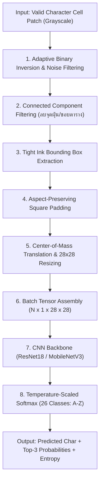

# Phase 4: Handwritten Character Recognition (HCR CNN Engine)
**ไฟล์โมดูลเป้าหมาย:** `src/recognition/char_classifier.py` และ `src/recognition/train_hcr.py`  
**อ้างอิงทฤษฎี:** *OMRNet (MTAP 2024)*, *TrOCR (AAAI 2023)* และแผนการดำเนินงาน *Rayong MARCO Progress Report*

---

## 1. วัตถุประสงค์และขอบเขตการทำงาน (Objective & Scope)
เมื่อช่องตัวอักษรผ่านการคัดกรองจาก Phase 2 (ไม่ใช่ช่องว่างเปล่า) และ Phase 3 (ไม่ได้ถูกขีดฆ่า 2 เส้น `=`) ช่องดังกล่าวจะถูกส่งเข้าสู่โมดูลอ่านตัวอักษรภาษาอังกฤษลายมือเขียน (Handwritten Character Recognition: HCR)
- **ขอบเขตคลาสเป้าหมาย:** ตัวอักษรภาษาอังกฤษพิมพ์ใหญ่ **`A` ถึง `Z` จำนวน 26 คลาส** (ดัชนี $0 \dots 25$)
- **ปัญหา Domain Gap สำคัญ:** โมเดลที่เทรนบนชุดข้อมูลมาตรฐาน **EMNIST Letters** เพียงอย่างเดียวมักมีความแม่นยำลดลงเมื่อเจอลายมือนักเรียนไทยและภาพถ่ายจากกระดาษข้อสอบจริง เนื่องจากความหนาของเส้นปากกา ขอบตารางที่อาจหลงเหลือ และการวางตำแหน่งตัวอักษรที่ไม่กึ่งกลางช่อง
- **เป้าหมายของ Phase 4:**
  1. ออกแบบ **Canonical Glyph Normalization Pipeline** ที่แปลงภาพถ่ายตัวอักษรจากกระดาษจริงให้มีคุณลักษณะทางสถิติเหมือนกับภาพใน EMNIST มากที่สุด
  2. พัฒนาและเทรนโมเดล **Lightweight CNN (ResNet18 / MobileNetV3-Small)** ด้วยกลยุทธ์ Two-Stage Transfer Learning (Pre-train บน EMNIST $\to$ Fine-tune บนชุดข้อมูลลายมือนักเรียนจริง)
  3. ประมวลผลแบบ **Row-Batch Inference** (อ่านพร้อมกันทั้งแถวในครั้งเดียว) ให้ใช้เวลาไม่เกิน $8\text{ ms}$ ต่อข้อ และได้ความแม่นยำ Top-1 Accuracy $\ge 75\%$ (สูงกว่าเป้าหมายขั้นต่ำใน Progress Report ที่ตั้งไว้ 60–70%)

---

## 2. ลำดับขั้นตอนของอัลกอริทึม (Algorithmic Pipeline)



---

## 3. รายละเอียดทางคณิตศาสตร์และการคำนวณเชิงลึก

### 3.1 การเตรียมภาพตัวอักษรให้เป็นมาตรฐานเดียวกัน (Canonical Glyph Normalization)
เพื่อให้ภาพจากกระดาษคำตอบเข้ากันได้กับมาตรฐาน EMNIST ($28 \times 28$ พิกเซล):
1. **การแยกหมึกและลบจุดรบกวน (Binarization & Denoising):**
   - ใช้ Gaussian Thresholding ผสม Otsu เพื่อให้ตัวอักษรมีค่าเป็นสีขาว ($255$) บนพื้นหลังสีดำ ($0$)
   - ลบ Connected Components ขนาดเล็กที่มีพื้นที่น้อยกว่า $12\text{ px}^2$ (จุดฝุ่นหรือรอยจุดปากกา)
2. **การตัดกรอบชิดขอบตัวอักษร (Tight Bounding Box Crop):**
   หาพิกัด $(x_{\min}, y_{\min}, x_{\max}, y_{\max})$ ของพิกเซลหมึกทั้งหมด แล้วตัดภาพย่อยขนาด $w_c \times h_c$
3. **การปรับความหนาเส้น (Stroke Width Normalization):**
   หากอัตราส่วนพิกเซลหมึกต่อพื้นที่กรอบต่ำเกินไป (ปากกาหัวแหลมมาก) จะทำ Morphological Dilation ด้วย Kernel $(2, 2)$ 1 รอบเพื่อให้ความหนาเส้นใกล้เคียงกับ EMNIST
4. **การเติมขอบสี่เหลี่ยมจัตุรัสและการจัดจุดศูนย์ถ่วงมวล (Aspect-Ratio Padding & Center of Mass):**
   - สร้างแคนวาสสี่เหลี่ยมจัตุรัสขนาด $L = \max(w_c, h_c) + 2p_{\text{pad}}$ แล้ววางตัวอักษรไว้ตรงกลาง
   - ย่อขนาดด้วย `cv2.INTER_AREA` เป็น $20 \times 20\text{ px}$ แล้ววางลงในแคนวาส $28 \times 28\text{ px}$ โดยเลื่อนจุดศูนย์ถ่วงมวล (Center of Mass: $\mathbf{c}_m$) ให้ตรงกับจุดกึ่งกลางภาพ $(14, 14)$:
     $$c_{m,x} = \frac{\sum_{x,y} x \cdot I(x,y)}{\sum_{x,y} I(x,y)}, \quad c_{m,y} = \frac{\sum_{x,y} y \cdot I(x,y)}{\sum_{x,y} I(x,y)}$$
   - Normalize ค่าความเข้มพิกเซลด้วยค่าเฉลี่ยและส่วนเบี่ยงเบนมาตรฐาน:
     $$\tilde{I} = \frac{I / 255.0 - \mu_{\text{emnist}}}{\sigma_{\text{emnist}}} \quad (\mu = 0.1307, \sigma = 0.3081)$$

---

### 3.2 สถาปัตยกรรมโมเดลและกลยุทธ์การเทรน (Model Architecture & Two-Stage Training)

#### สถาปัตยกรรมโมเดล (Modified ResNet-18 / MobileNetV3 for $28 \times 28$ Input):
- เปลี่ยนเลเยอร์แรก (`conv1`) จากขนาด Kernel $7 \times 7$, Stride $2$ เป็น **Kernel $3 \times 3$, Stride $1$, Padding $1$** และตัด `maxpool` แรกออก เพื่อรักษาความละเอียดเชิงพื้นที่ของภาพขนาดเล็ก $28 \times 28$ ไม่ให้สูญหายเร็วเกินไป
- เลเยอร์สุดท้าย (`fc` classifier): เชื่อมต่อจาก Feature Vector เข้าสู่ Linear Layer ขนาด 26 เอาต์พุต (A–Z)

#### กลยุทธ์การเทรน 2 ขั้นตอน (Two-Stage Transfer Learning):
1. **Stage 1: Pre-training บน EMNIST Letters (145,600 ภาพ)**
   - **หมายเหตุสำคัญของ EMNIST:** ภาพในชุดข้อมูล EMNIST ดั้งเดิมถูก Transpose (หมุนและพลิกแกน) อยู่ ต้องทำ `np.transpose(img)` ให้กลับมาเป็นทิศทางตั้งตรงปกติก่อนเทรนเสมอ!
   - ใช้ Optimizer **AdamW** ($\text{lr} = 10^{-3}, \text{weight\_decay} = 10^{-4}$) ร่วมกับ **Cosine Annealing Learning Rate Scheduler** จำนวน 25 Epochs
   - ใช้ **Label Smoothing Cross-Entropy Loss** ($\epsilon = 0.10$):
     $$\mathcal{L}_{\text{CE}} = -\sum_{k=1}^{26} q_k \log P(y = k \mid \mathbf{x}), \quad q_k = (1 - \epsilon)\mathbb{I}(k = y_{\text{true}}) + \frac{\epsilon}{26}$$
2. **Stage 2: Domain Adaptation & Fine-tuning บนลายมือจริง (Rayong Handwritten Dataset)**
   - Freeze เลเยอร์ต้น (`layer1`, `layer2`) และปลดล็อกเฉพาะ `layer3`, `layer4`, และ `fc`
   - ใช้ Learning Rate ต่ำ ($\text{lr} = 2 \times 10^{-4}$) เทรนต่ออีก 15–20 Epochs พร้อม **Synthetic Grid-Artifact Augmentation** (สุ่มเติมเส้นขอบตารางบางๆ ที่ขอบภาพระหว่างเทรน เพื่อให้โมเดลไม่สับสนเมื่อตัดช่องติดเส้นตารางมาเล็กน้อย)

---

### 3.3 การวัดความเชื่อมั่นและการคัดกรองความไม่แน่นอน (Confidence Calibration & Entropy)
สำหรับการทำนายในแต่ละช่อง นอกจากตัวอักษรที่ได้ความน่าจะเป็นสูงสุด $\hat{y} = \arg\max_k P_k$ แล้ว ระบบจะคำนวณ:
1. **Top-1 Confidence:** $C_{\text{top1}} = \max_k P_k$
2. **Prediction Margin:** $\Delta P = P_{(1)} - P_{(2)}$ (ผลต่างระหว่างอันดับ 1 และอันดับ 2 เช่น กรณีลังเลระหว่าง `O` กับ `D` หรือ `I` กับ `L`)
3. **Shannon Entropy:**
   $$H(P) = -\sum_{k=1}^{26} P_k \log_2(P_k + 10^{-12})$$
   หาก $C_{\text{top1}} < 0.55$ หรือ $\Delta P < 0.15$ ช่องนั้นจะถูกติดธง `low_confidence_flag = True` เพื่อให้ Phase 5 ใช้ตัดสินใจส่งให้ครูตรวจซ้ำ

---

## 4. โครงสร้างโค้ดและการออกแบบคลาส (Implementation Blueprint)

```python
# src/recognition/char_classifier.py
import torch
import torch.nn as nn
import numpy as np
from dataclasses import dataclass
from typing import List, Tuple

@dataclass
class CharPrediction:
    predicted_char: str                 # 'A' - 'Z'
    confidence: float                   # 0.0 - 1.0
    top3_chars: List[Tuple[str, float]] # [('A', 0.91), ('R', 0.05), ('H', 0.02)]
    entropy: float
    is_low_confidence: bool

class HCRModelEngine:
    Alphabet = "ABCDEFGHIJKLMNOPQRSTUVWXYZ"

    def __init__(self, weights_path: str, device: str = "cpu"):
        self.device = torch.device(device)
        # โหลดโมเดล ResNet18_28x28 หรือ MobileNetV3
        pass

    def predict_row_batch(self, cell_images: List[np.ndarray]) -> List[CharPrediction]:
        """
        รับรายการภาพช่องตัวอักษรใน 1 ข้อ (สูงสุด 15 ช่อง) มาทำนายพร้อมกันแบบ Batch
        """
        pass
```

---

## 5. ตัวชี้วัดเชิงปริมาณและเกณฑ์การผ่าน (Quantitative Metrics & Verification)

ในการเทรนและประเมินผลโมเดล Phase 4 ทุกครั้ง จะต้องบันทึกผลตัวเลขดังนี้ลงในไฟล์รายงาน `reports/phase4_hcr_metrics.json`:

1. **Top-1 Classification Accuracy:**
   $$\text{Top-1 Acc} = \frac{1}{N} \sum_{i=1}^{N} \mathbb{I}(\hat{y}_i = y_i)$$
   - **เกณฑ์เป้าหมายบน EMNIST Validation Set:** $\ge 93.5\%$
   - **เกณฑ์เป้าหมายบนกระดาษลายมือจริง (Real Exam Sheets):** $\ge 75.0\%$ *(สูงกว่าเกณฑ์ 60–70% ใน Progress Report)*
2. **Top-3 Classification Accuracy:**
   - **เกณฑ์เป้าหมาย:** $\ge 92.0\%$ (มีประโยชน์อย่างยิ่งเมื่อนำไปทำ Dictionary/Spell Correction เสริมในอนาคต)
3. **Macro-Averaged Precision, Recall, and F1-Score (ครบทั้ง 26 คลาส A–Z):**
   $$\text{Macro-F1} = \frac{1}{26} \sum_{k=1}^{26} \text{F1}_k \ge 0.74$$
4. **Confusion Matrix Analysis:**
   สร้างตาราง $26 \times 26$ เพื่อระบุคู่ตัวอักษรที่สับสนบ่อยที่สุด (เช่น `U`/`V`, `O`/`Q`, `I`/`J`, `M`/`N`)
5. **Expected Calibration Error (ECE):** $\le 0.05$
6. **Inference Latency:** $\le 8.0\text{ ms}$ ต่อ 1 ข้อ (Batch ขนาด 15 ช่อง) บน CPU
