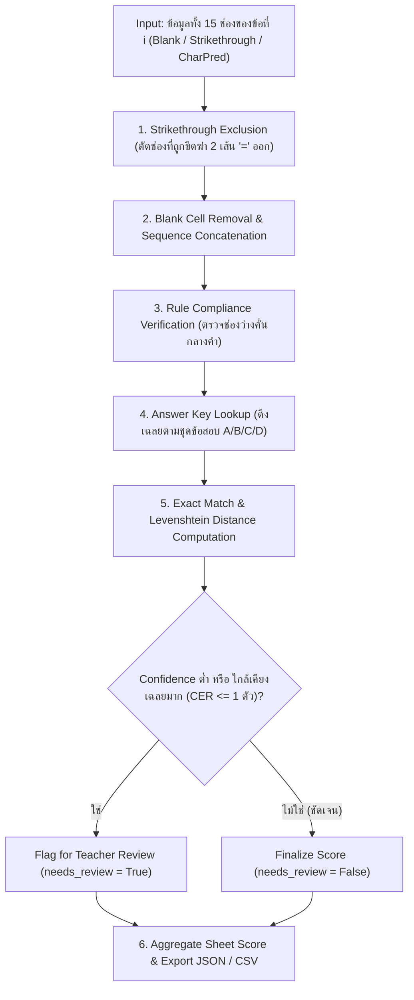

# Phase 5: Word Assembly & Automated Grading Engine
**ไฟล์โมดูลเป้าหมาย:** `src/evaluation/grading_engine.py` และ `src/evaluation/metrics.py`  
**อ้างอิงทฤษฎี:** *Computer Vision Rayong MARCO - Progress Report (Rules & Goal Specification)*

---

## 1. วัตถุประสงค์และขอบเขตการทำงาน (Objective & Scope)
Phase 5 คือส่วนสรุปผลปลายทาง (End-to-End Decision & Grading Engine) ที่รวบรวมผลลัพธ์จากทุก Phase ก่อนหน้า:
- รหัสนักเรียนและชุดข้อสอบจาก **Phase 2**
- สถานะการขีดฆ่า 2 เส้น (`is_crossed`) รายช่องจาก **Phase 3**
- ตัวอักษรที่ทำนายได้ (`predicted_char`) และค่าความเชื่อมั่น (`confidence`) จาก **Phase 4**

**เป้าหมายของ Phase 5:**
1. นำตัวอักษรรายช่องมาประกอบกันเป็นคำตอบระดับคำ (Word Assembly) ตามกฎของข้อสอบ Rayong MARCO อย่างเคร่งครัด
2. เปรียบเทียบคำตอบของนักเรียนกับชุดเฉลยที่ตรงกับชุดข้อสอบ (Key Matching) เพื่อคำนวณคะแนนรายข้อและคะแนนรวม
3. คัดกรองข้อที่มีความกำกวม (Human-in-the-Loop Review Flagging) เพื่อให้ครูตรวจสอบซ้ำเฉพาะข้อที่ไม่ชัดเจน
4. ส่งออกผลลัพธ์เป็นไฟล์มาตรฐาน **JSON** และ **CSV** พร้อมคำนวณตัวชี้วัดประสิทธิภาพระดับ End-to-End ครบทุกมิติ

---

## 2. ลำดับขั้นตอนของอัลกอริทึม (Algorithmic Pipeline)



---

## 3. กฎการประกอบคำและเกณฑ์การตรวจข้อสอบ (Word Assembly & Grading Rules)

อ้างอิงจากหน้า 6 ของเอกสาร *Computer Vision Rayong MARCO - Progress Report* ระบบบังคับใช้กฎดังต่อไปนี้:

### 3.1 ตารางจำลองสถานการณ์การประกอบคำ (Truth Table of Word Assembly)

| กรณีตัวอย่างบนกระดาษ (15 ช่อง) | สถานะที่ตรวจพบรายช่อง | คำที่ประกอบได้ (Assembled Word) | ผลการตรวจ (เฉลย: `APPLE`) | คำอธิบายตามเกณฑ์ |
|:---|:---|:---:|:---:|:---|
| `[A][P][P][L][E][ ][ ]...` | ปกติ 5 ช่องแรก | `"APPLE"` | **1 คะแนน** (ถูก) | เขียนตัวพิมพ์ใหญ่เรียงติดกันถูกต้อง |
| `[A][P][P][L][E][=D=][ ]...` | ช่อง 6 พบขีดฆ่า 2 เส้น `=` | `"APPLE"` | **1 คะแนน** (ถูก) | ช่องที่ขีดฆ่า 2 เส้นถูกข้ามโดยสมบูรณ์ |
| `[=B=][A][P][P][L][E][ ]...` | ช่อง 1 พบขีดฆ่า 2 เส้น `=` | `"APPLE"` | **1 คะแนน** (ถูก) | ขีดฆ่าช่องแรกแล้วเริ่มเขียนใหม่ในช่องถัดไป |
| `[A][P][=X=][P][L][E][ ]...` | ช่อง 3 พบขีดฆ่า 2 เส้น `=` | `"APPLE"` | **1 คะแนน** (ถูก) | ขีดฆ่าตรงกลางคำ ระบบยุบรวมตัวที่เหลือเข้าด้วยกัน |
| `[A][P][ ][P][L][E][ ]...` | ช่อง 3 ว่างเปล่า (ไม่ได้ขีดฆ่า) | `"AP PLE"` | **0 คะแนน** (ผิด + Flag) | เว้นช่องว่างกลางคำโดยไม่มีรอยขีดฆ่า |

### 3.2 อัลกอริทึมการประกอบคำเชิงคณิตศาสตร์
สำหรับข้อที่ $i \in \{1, \dots, 20\}$ ที่มีลำดับช่อง $j \in \{0, \dots, 14\}$:
1. กำหนดสถานะของแต่ละช่อง $s_{i,j} \in \{\text{EMPTY}, \text{STRIKETHROUGH}, \text{VALID\_CHAR}\}$
2. กรองช่องที่ถูกขีดฆ่า 2 เส้นออกจากการพิจารณา:
   $$\mathcal{J}_{\text{active}} = \{ j \in \{0, \dots, 14\} \mid s_{i,j} \neq \text{STRIKETHROUGH} \}$$
3. หากในลำดับ $\mathcal{J}_{\text{active}}$ มีช่อง $\text{VALID\_CHAR}$ ปรากฏอยู่ ให้ตัดช่อง $\text{EMPTY}$ ที่อยู่ทางซ้ายสุดและขวาสุดออก (Leading & Trailing Empty Trim)
4. นำตัวอักษรที่เหลือมาต่อกันเป็นสตริง $\hat{W}_i$ และคำนวณความเชื่อมั่นระดับคำ (Word-Level Confidence):
   $$C_{\text{word}}(i) = \left( \prod_{j \in \mathcal{J}_{\text{valid}}} C_{\text{top1}}(i, j) \right)^{\frac{1}{|\mathcal{J}_{\text{valid}}|}} \quad (\text{Geometric Mean})$$

---

### 3.3 เงื่อนไขการแจ้งเตือนให้ครูตรวจซ้ำ (Human-in-the-Loop Review Flagging)
เพื่อให้ระบบนำไปใช้งานจริงในโรงเรียนได้อย่างปลอดภัยสูงสุด ข้อที่ $i$ จะถูกตั้งค่า `needs_teacher_review = True` เมื่อเข้าข่ายข้อใดข้อหนึ่งต่อไปนี้:
1. **Low Character Confidence:** มีตัวอักษรอย่างน้อย 1 ตัวในคำที่มี $C_{\text{top1}} < 0.55$
2. **Near-Miss Top-K Match:** คำที่อ่านได้จาก Top-1 ($\hat{W}_i$) ผิดไปจากเฉลย $W_i^*$ เพียง 1 ตัวอักษร ($\text{Levenshtein}(\hat{W}_i, W_i^*) = 1$) **และ** ตัวอักษรที่ถูกต้องตามเฉลยปรากฏอยู่ใน **Top-3 Candidates** ของโมเดล CNN ในช่องนั้น!
3. **Ambiguous Strikethrough:** คะแนนความมั่นใจของรอยขีดฆ่า 2 เส้นอยู่ในช่วงก้ำกึ่ง $S_{\text{strike}} \in [0.45, 0.60]$

---

## 4. รูปแบบข้อมูลส่งออก (Standard JSON & CSV Output Schema)

### 4.1 โครงสร้างไฟล์ JSON รายบุคคล (`results/student_67160366.json`)
```json
{
  "sheet_id": "sheet_001",
  "student_id": "67160366",
  "exam_set": "A",
  "total_score": 18,
  "max_score": 20,
  "processing_time_ms": 142.5,
  "flagged_questions_count": 1,
  "questions": [
    {
      "question_no": 1,
      "predicted_word": "APPLE",
      "ground_truth_key": "APPLE",
      "is_correct": true,
      "score": 1,
      "word_confidence": 0.942,
      "strikethrough_cells": [5],
      "needs_teacher_review": false,
      "review_reason": null
    }
  ]
}
```

---

## 5. ตัวชี้วัดเชิงปริมาณระดับระบบ (End-to-End Quantitative Metrics)

โมดูล `src/evaluation/metrics.py` จะคำนวณตัวชี้วัดทางสถิติเพื่อสรุปผลเทียบกับเป้าหมายของโครงการดังนี้:

### 5.1 Character Error Rate (CER)
วัดอัตราความผิดพลาดระดับตัวอักษรด้วยระยะทาง Levenshtein (จำนวนการเพิ่ม ลบ หรือแทนที่ตัวอักษรที่น้อยที่สุด):
$$\text{CER} = \frac{\sum_{i=1}^{N_{\text{total}}} \text{Levenshtein}(\hat{W}_i, W_i^{\text{human}})}{\sum_{i=1}^{N_{\text{total}}} |W_i^{\text{human}}|} \times 100\%$$
- **เกณฑ์เป้าหมาย (Target):** $\text{CER} \le 4.0\%$

### 5.2 Exact Match Word Accuracy (EMA / Word Recognition Rate)
สัดส่วนของคำตอบที่ระบบอ่านและประกอบคำได้ตรงกับสิ่งที่นักเรียนตั้งใจเขียนบนกระดาษทุกตัวอักษร:
$$\text{EMA} = \frac{1}{N_{\text{total}}} \sum_{i=1}^{N_{\text{total}}} \mathbb{I}(\hat{W}_i == W_i^{\text{human}}) \times 100\%$$
- **เกณฑ์เป้าหมาย (Target):** $\text{EMA} \ge 90.0\%$

### 5.3 Grading Decision Accuracy & Cohen's Kappa ($\kappa$)
วัดความตรงกันของการให้คะแนน (ได้ 1 หรือ 0 คะแนน) ระหว่างระบบอัตโนมัติกับการตรวจของครูจริง:
$$\text{Grading Accuracy} = \frac{\text{จำนวนข้อที่ระบบให้คะแนนตรงกับครู}}{N_{\text{total}}} \times 100\%$$
- **เกณฑ์เป้าหมาย (Target):** Grading Accuracy $\ge 95.0\%$, Cohen's $\kappa \ge 0.90$

### 5.4 Student Total Score Correlation (Pearson's $r$ & MAE)
เปรียบเทียบคะแนนรวมเต็ม 20 คะแนนของนักเรียนแต่ละคน ($S_{\text{pred}}$ เทียบกับ $S_{\text{teacher}}$):
$$r = \frac{\sum (S_{\text{pred}} - \bar{S}_{\text{pred}})(S_{\text{teacher}} - \bar{S}_{\text{teacher}})}{\sqrt{\sum (S_{\text{pred}} - \bar{S}_{\text{pred}})^2 \sum (S_{\text{teacher}} - \bar{S}_{\text{teacher}})^2}}, \quad \text{MAE} = \frac{1}{M}\sum_{m=1}^{M} |S_{\text{pred}}^{(m)} - S_{\text{teacher}}^{(m)}|$$
- **เกณฑ์เป้าหมาย (Target):** Pearson $r \ge 0.99$, $\text{MAE} \le 0.40\text{ คะแนน/แผ่น}$
