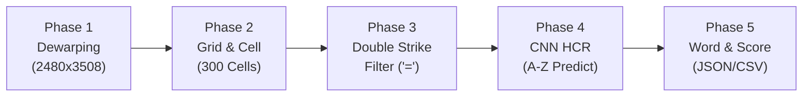

# แผนแม่บทระบบตรวจกระดาษคำตอบอัตโนมัติ Rayong MARCO (Template 2)
**โครงการ:** Computer Vision — Automated Handwritten & OMR Exam Grading Pipeline  
**อ้างอิงหลักการวิจัย:** SNPD 2025 (Cross-Linear Area & Homography), DocUNet (CVPR 2018), OMRNet (MTAP 2024), CascadeTabNet (CVPRW 2020), TrOCR (AAAI 2023)

---

## สารบัญเอกสารแยกตาม Phase (Detailed Phase Specifications)

เอกสารแผนการดำเนินงานฉบับนี้ถูกแยกออกเป็น 5 Phases เชิงลึก เพื่อให้ทีมพัฒนาสามารถนำไปอ้างอิง ทดสอบ และวัดผลเชิงปริมาณ (Quantitative Metrics) ในแต่ละส่วนได้อย่างอิสระและมีประสิทธิภาพสูงสุด:

1. **[Phase 1: Preprocessing & Fiducial Dewarping](./Phase1_Preprocessing_and_Dewarping.md)**
   - การตรวจจับสี่เหลี่ยมดำ 3 จุด (3 Fiducial Corner Markers)
   - อัลกอริทึมตรวจสอบการหมุนภาพอัตโนมัติ (0°, 90°, 180°, 270°) ด้วยทฤษฎีบทพีทาโกรัสและด้านตรงข้ามมุมฉาก (Hypotenuse Vector Analysis)
   - การประมาณค่าพิกัดจุดมุมที่ 4 (Top-Left Corner Estimation) และการแปลง Projective Homography กลับสู่ขนาดมาตรฐาน $2480 \times 3508$ px (300 DPI)
   - **ตัวชี้วัดหลัก:** Reprojection RMSE ($\le 3.0\text{ px}$), Paper IoU ($\ge 0.95$), Orientation Accuracy ($100\%$), Latency ($\le 35\text{ ms}$)

2. **[Phase 2: Anchor Bar Tracking & Cell Localization](./Phase2_Grid_and_Cell_Localization.md)**
   - การสแกนแถบขีดดำด้านซ้าย-ขวา (Left/Right Timing Marks) จำนวน 20 ขีดเพื่อระบุแนวบรรทัดของข้อสอบข้อ 1–20
   - การคำนวณแนวเส้นบรรทัดแบบลาดเอียงไดนามิก (Dynamic Row Baseline Interpolation) ทนทานต่อการโก่งโค้งของกระดาษ
   - การตัดแบ่งช่องตัวอักษร 15 ช่องต่อข้อ (รวม 300 ช่อง) พร้อม Margin Removal ลบเส้นขอบตาราง
   - การสกัดช่องรหัสนักเรียนและวงกลมเลือกชุดข้อสอบด้วยอัลกอริทึม Cross-Linear Area (CLA)
   - **ตัวชี้วัดหลัก:** Timing Bar Recall ($100\%$), Cell Precision & Recall ($\ge 99.5\%$), Cell Bounding Box IoU ($\ge 0.92$)

3. **[Phase 3: Double Strikethrough Detection Filter ('=')](./Phase3_Double_Strikethrough_Detection.md)**
   - การสกัดเส้นแนวนอนด้วย Morphological Horizontal Opening Kernel
   - การคำนวณ Horizontal Projection Profile (HPP) และการจับคู่ยอดกราฟเส้นขนาน 2 เส้น (Separation Gap $7 - 35\text{ px}$)
   - กลไกป้องกันการตรวจจับผิดพลาด (Anti-False Positive Guard) สำหรับตัวอักษรที่มีขีดแนวนอน เช่น `E`, `F`, `H`, `B`, `A`, `T`, `Z`
   - **ตัวชี้วัดหลัก:** Strikethrough Accuracy ($\ge 96\%$), F1-Score ($\ge 0.94$), False Positive Rate บนตัวอักษรปกติ ($\le 1.5\%$)

4. **[Phase 4: Handwritten Character Recognition (HCR CNN Engine)](./Phase4_Character_Recognition_HCR.md)**
   - กระบวนการเตรียมภาพตัวอักษรรายช่อง (Noise Removal, Tight Bounding Box, Aspect-Preserving Padding, Center-of-Mass Alignment, $28 \times 28$ Normalization)
   - สถาปัตยกรรมโมเดล Lightweight CNN (ResNet18 / MobileNetV3) และการทำ Transfer Learning จาก EMNIST Letters (145,600 ภาพ) สู่ลายมือนักเรียนจริง
   - เทคนิค Data Augmentation และการทำ Row-Batch Inference (15 ช่องพร้อมกันในคำสั่งเดียว)
   - **ตัวชี้วัดหลัก:** Top-1 Accuracy ($\ge 75\%$), Top-3 Accuracy ($\ge 92\%$), Macro F1-Score ($\ge 0.74$), Batch Latency ($\le 8\text{ ms/row}$)

5. **[Phase 5: Word Assembly & Automated Grading Engine](./Phase5_Word_Assembly_and_Grading.md)**
   - กฎการประกอบคำ (Word Assembly Logic) โดยการข้ามช่องที่ถูกขีดฆ่า 2 เส้น และการจัดการช่องว่าง (Whitespace Sanitization)
   - การจับคู่ชุดเฉลย (Key Matching), การคำนวณ Edit Distance (Levenshtein) และกลไกคัดกรองข้อที่มีความมั่นใจต่ำ (Human-in-the-Loop Review Flagging)
   - รูปแบบไฟล์ส่งออกมาตรฐาน JSON และ CSV รายบุคคล
   - **ตัวชี้วัดหลัก:** Exact Match Word Accuracy ($\ge 90\%$), Character Error Rate ($\text{CER} \le 4\%$), Score Correlation ($r \ge 0.99$)

---

## ผังการทำงานเชื่อมต่อระหว่าง 5 Phases (Master Pipeline Architecture)

---

## ตารางสรุปตัวชี้วัดเชิงปริมาณรวมทั้งระบบ (Master Quantitative Metrics Table)

| Phase | โมดูลหลัก | ตัวชี้วัดหลัก (Primary Metric) | ตัวชี้วัดรอง (Secondary Metric) | เป้าหมาย (Target SLA) |
|:---:|:---|:---|:---|:---:|
| **Phase 1** | `src/preprocessing/dewarp.py` | Reprojection RMSE (px) | Paper Boundary IoU | $\le 3.0\text{ px}$ / $\ge 0.95$ |
| **Phase 2** | `src/detection/grid_extractor.py` | Cell Localization Recall (%) | Cell Box IoU | $\ge 99.5\%$ / $\ge 0.92$ |
| **Phase 3** | `src/recognition/strikethrough_detector.py` | Strikethrough F1-Score | False Positive Rate (FPR) | $\ge 0.94$ / $\le 1.5\%$ |
| **Phase 4** | `src/recognition/char_classifier.py` | Top-1 Character Accuracy (%) | Macro F1-Score & Top-3 Acc | $\ge 75.0\%$ / $\ge 92.0\%$ |
| **Phase 5** | `src/evaluation/grading_engine.py` | Exact Word Match Accuracy (%) | Character Error Rate (CER) | $\ge 90.0\%$ / $\le 4.0\%$ |
